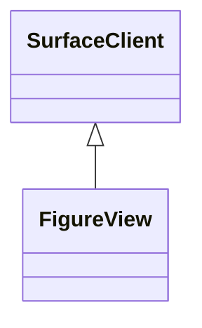

# FigureView

**Namespace:** `mne::viz` &nbsp;·&nbsp; **Library:** Visualization Library &nbsp;·&nbsp; **Source:** [`viz/panels/figure_view.h`](https://github.com/mne-tools/mne-cpp/blob/staging/src/libs/mne/viz/panels/figure_view.h)

`#include <mne/viz/figure_view.h>`

```cpp
class mne::viz::FigureView
```

Navigation and drawing of a [`SceneFigure`](/docs/api/viz/scene-figure) for any host: a window without a toolkit or a Qt widget.

A zoomable figure is fitted into the view, keeping its aspect ratio, and stays fitted as the view resizes until the user zooms or pans: the wheel zooms by 1.15 per notch around the pointer, the right button pans, a double click fits again and a left drag outside an item spans a rubber band if the figure wants one. A figure that is not zoomable lays itself out to the view size and the wheel scrolls it vertically. Hovers, clicks and bands reach the figure in scene coordinates.

```cpp title="src/examples/ex_scene_sdl/main.cpp"
// An N100-like deflection that grows towards the back of the grid, and a later positive wave
auto info = std::make_shared<mne::FiffInfo>();
Eigen::MatrixXd auditory = Eigen::MatrixXd::Zero(kSensors, kSamples);
std::vector<AverageLayoutFigure::Channel> selection;
for (int i = 0; i < kSensors; ++i) {
    const int row = i / 4;
    const int column = i % 4;
    mne::FiffChInfo channel;
    channel.ch_name = "EEG " + std::to_string(i + 1);
    channel.kind = FIFFV_EEG_CH;
    channel.unit = FIFF_UNIT_V;
    info->chs.push_back(channel);
    info->ch_names.push_back(channel.ch_name);
    for (int s = kPreStimulus; s < kSamples; ++s) {
        const double t = (s - kPreStimulus) / kSfreq;
        const double n100 = -std::exp(-std::pow((t - 0.1) / 0.02, 2));
        const double p300 = 0.6 * std::exp(-std::pow((t - 0.3) / 0.05, 2));
        auditory(i, s) = (n100 * (1.0 + row) + p300) * 5e-6;
    }
    AverageLayoutFigure::Channel tile;
    tile.name = channel.ch_name;
    tile.number = i;
    tile.position = {1.6 * column, -1.2 * row};
    selection.push_back(std::move(tile));
}
info->nchan = kSensors;

AverageLayoutPanel panel;
panel.set_info(info);
panel.set_selection(std::move(selection));
panel.set_scale_map({{FIFFV_EEG_CH, 1e-5f}});
panel.set_average_colors({{"auditory", Color{31, 111, 235}}});
EvokedAverages evoked;
evoked.averages = {{"auditory", auditory.data(), kSamples, kSensors}};
evoked.first_sample = -kPreStimulus;
evoked.bad.assign(kSensors, false);
evoked.bad[5] = true;
panel.set_evoked(std::move(evoked));

// Any panel's figure, without a view written for it
FigureView view(*panel.figure());
view.set_text_metrics(&metrics);
return host.run(view);
```

### Inheritance



---

## Public Methods

### FigureView(figure, theme)

Shows `figure`, which must outlive the view, on a white background.

**Parameters:**

- **figure** : *[SceneFigure](/docs/api/viz/scene-figure) &*
  The figure.

- **theme** : *[Theme](/docs/api/viz/theme)*
  Colours of the rubber band.

---

### ~FigureView()

---

### FigureView()

---

### operator=()

---

### figure()

**Returns:**

- *[SceneFigure](/docs/api/viz/scene-figure) &* — The figure.

---

### set_theme(theme)

**Parameters:**

- **theme** : *[Theme](/docs/api/viz/theme)*
  Colours of the rubber band.

---

### set_background(color)

**Parameters:**

- **color** : *[Color](/docs/api/viz/color)*
  Colour behind the figure.

---

### background()

**Returns:**

- *[Color](/docs/api/viz/color)* — The colour behind the figure.

---

### set_font(font)

**Parameters:**

- **font** : *[Font](/docs/api/viz/font)*
  Base font the figure draws its text with.

---

### font()

**Returns:**

- *const [Font](/docs/api/viz/font) &* — The base font the figure draws its text with.

---

### set_text_metrics(metrics)

**Parameters:**

- **metrics** : *const [TextMetrics](/docs/api/viz/text-metrics) **
  Metrics of the fonts the host draws with; must outlive the view. Null restores the approximate metrics.

---

### set_view_size(width, height)

**Parameters:**

- **width** : *double*
  Width of the view.

- **height** : *double*
  Height of the view.

---

### view_width()

**Returns:**

- *double* — Width of the view.

---

### view_height()

**Returns:**

- *double* — Height of the view.

---

### fit_to_contents()

Fits a zoomable figure into the view and keeps it fitted as the view resizes until the user zooms or pans; scrolls other figures to the top.

---

### fitted()

**Returns:**

- *bool* — Whether the figure is kept fitted.

---

### zoom()

**Returns:**

- *double* — View units per scene unit.

---

### zoom_by(factor, anchor)

Zooms a zoomable figure by `factor`, keeping the scene point under `anchor` in place.

**Parameters:**

- **factor** : *double*
  Factor, above 1 to zoom in.

- **anchor** : *[Point](/docs/api/viz/point)*
  Fixed point in view coordinates.

---

### pan_by(dx, dy)

Moves a zoomable figure, or scrolls another figure vertically.

**Parameters:**

- **dx** : *double*
  Horizontal offset in view units.

- **dy** : *double*
  Vertical offset in view units.

---

### map_to_scene(point)

**Parameters:**

- **point** : *[Point](/docs/api/viz/point)*
  [`Point`](/docs/api/viz/point) in view coordinates.

**Returns:**

- *[Point](/docs/api/viz/point)* — The point in scene coordinates.

---

### map_from_scene(point)

**Parameters:**

- **point** : *[Point](/docs/api/viz/point)*
  [`Point`](/docs/api/viz/point) in scene coordinates.

**Returns:**

- *[Point](/docs/api/viz/point)* — The point in view coordinates.

---

### band()

**Returns:**

- *std::optional&lt; [Rect](/docs/api/viz/rect) &gt;* — The rubber band in view coordinates while one is spanned.

---

### leave()

Tells the figure that the pointer left the view.

---

### draw()

**Returns:**

- *[DisplayList](/docs/api/viz/display-list)* — The view: background, figure and rubber band, in view coordinates.

---

### picture(width, height)

The figure fitted into a picture of its own, e.g.

to export it with `write_svg()`.

**Parameters:**

- **width** : *double*
  Width of the picture.

- **height** : *double*
  Height of the picture.

**Returns:**

- *[DisplayList](/docs/api/viz/display-list)* — The figure on the background colour; a figure that is not zoomable is laid out to the picture.

---

### resize(size)

The surface changed its size.

**Parameters:**

- **size** : *const [SurfaceSize](/docs/api/viz/surface-size) &*
  The new size.

---

### handle_pointer(event)

A pointer pressed, moved, released or double-clicked over the surface.

**Parameters:**

- **event** : *const [PointerEvent](/docs/api/viz/pointer-event) &*
  The pointer event.

**Returns:**

- *bool* — Whether the client used the event.

---

### handle_wheel(event)

The wheel turned or the touchpad scrolled over the surface.

**Parameters:**

- **event** : *const [WheelEvent](/docs/api/viz/wheel-event) &*
  The wheel event.

**Returns:**

- *bool* — Whether the client used the event.

---

### frame(target)

Describes the next frame.

**Parameters:**

- **target** : *const [GpuFrameTarget](/docs/api/viz/gpu-frame-target) &*
  Pixel size and clip-space correction of the host's render target.

**Returns:**

- *[GpuFrame](/docs/api/viz/gpu-frame)* — The frame, referring to `resources()`.

---

### resources()

**Returns:**

- *const [GpuResources](/docs/api/viz/gpu-resources) &* — Buffers, textures and pipelines the frames refer to.

---

## Example

- Start here: [ex_scene_sdl](../../examples/viz/ex_scene_sdl.mdx) — Trace view in an SDL3 window, without Qt: mne_scene's view and software renderer in another toolkit.
- Full source: [`src/examples/ex_scene_sdl/main.cpp`](https://github.com/mne-tools/mne-cpp/tree/staging/src/examples/ex_scene_sdl/main.cpp)
- Build target: `ex_scene_sdl` (runs under CTest)

## Used in examples

### [ex_scene_sdl](../../examples/viz/ex_scene_sdl.mdx)

Trace view in an SDL3 window, without Qt: mne_scene's view and software renderer in another toolkit.

````cpp title="src/examples/ex_scene_sdl/main.cpp, line 154"
    // Any panel's figure, without a view written for it
    FigureView view(*panel.figure());
    view.set_text_metrics(&metrics);
    return host.run(view);
}
````

## Authors of this file

- Christoph Dinh &lt;christoph.dinh@mne-cpp.org&gt;
