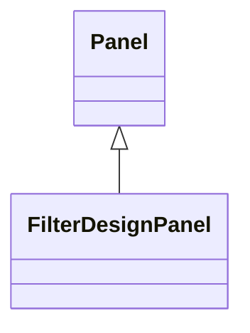

# FilterDesignPanel

**Namespace:** `mne::viz` &nbsp;·&nbsp; **Library:** Visualization Library &nbsp;·&nbsp; **Source:** [`viz/panels/filter_design_panel.h`](https://github.com/mne-tools/mne-cpp/blob/staging/src/libs/mne/viz/panels/filter_design_panel.h)

`#include <mne/viz/filter_design_panel.h>`

```cpp
class mne::viz::FilterDesignPanel
```

Tool panel that designs an FIR filter kernel from its type, pass band, number of taps, transition band and design method, and shows its magnitude response in a [`FilterResponseFigure`](/docs/api/viz/filter-response-figure).

The channel type tells the host which channels to filter. The panel writes the coefficients of the current kernel and its response plot (SVG or PNG) to files the user picks, and designs a kernel like one loaded from a coefficient file. The settings keep the keys of the former Qt view; the design method is stored as its index in `mne::FilterKernel::design_methods`.

### Inheritance



---

## Public Methods

### FilterDesignPanel()

Constructs the panel with a 1 to 40 Hz band pass of 128 taps, a 0.1 Hz transition band and the cosine method at 600 Hz, applied to all channels.

---

### ~FilterDesignPanel()

---

### set_callbacks(callbacks)

**Parameters:**

- **callbacks** : *Callbacks*
  What to call on changes.

---

### set_sampling_rate(sfreq)

Designs the kernel for a new sampling frequency, limiting the edges to its Nyquist frequency; silent.

**Parameters:**

- **sfreq** : *double*
  Sampling frequency in Hz; ignored if not positive.

---

### set_max_taps(taps)

Limits the number of taps to 16 up to `taps`, rounded down to even; silent.

**Parameters:**

- **taps** : *int*
  The largest number of taps.

---

### set_from(from)

**Parameters:**

- **from** : *double*
  Lower edge in Hz; designs the kernel without a report.

---

### set_to(to)

**Parameters:**

- **to** : *double*
  Upper edge in Hz; designs the kernel without a report.

---

### set_channel_type(type)

**Parameters:**

- **type** : *const std::string &*
  Channel type to filter: "All", "MEG", "EEG", "ECG", "EOG" or "EMG"; silent.

---

### from()

**Returns:**

- *double* — The lower edge in Hz.

---

### to()

**Returns:**

- *double* — The upper edge in Hz.

---

### taps()

**Returns:**

- *int* — The number of taps, rounded down to even.

---

### channel_type()

**Returns:**

- *std::string* — The channel type to filter.

---

### sampling_rate()

**Returns:**

- *double* — The sampling frequency in Hz.

---

### filter()

**Returns:**

- *const [FilterKernel](/docs/api/dsp/filter-kernel) &* — The current kernel.

---

### response()

**Returns:**

- *[FilterResponseFigure](/docs/api/viz/filter-response-figure) &* — The figure of the magnitude response.

---

### load_filter(path)

Takes type, edges, taps, transition band and method of the filter in `path` and designs the kernel with them at the current sampling frequency, reporting it like a user edit.

**Parameters:**

- **path** : *const std::filesystem::path &*
  Coefficient file written by [`FilterIO`](/docs/api/dsp/filter-io).

**Returns:**

- *[Expected](/docs/api/base/expected)&lt; void &gt;* — Nothing, or why the file could not be read.

---

### export_coefficients(path)

Writes the coefficients of the current kernel, named after its type, edges and sampling frequency.

**Parameters:**

- **path** : *const std::filesystem::path &*
  Text file to write.

**Returns:**

- *[Expected](/docs/api/base/expected)&lt; void &gt;* — Nothing, or why the file could not be written.

---

### export_plot(path, width, height)

Writes the response plot as SVG, or as PNG if `path` ends in ".png".

**Parameters:**

- **path** : *const std::filesystem::path &*
  File to write.

- **width** : *double*
  Width of the plot in pixels.

- **height** : *double*
  Height of the plot in pixels.

**Returns:**

- *[Expected](/docs/api/base/expected)&lt; void &gt;* — Nothing, or why the file could not be written.

---

### load(store, path)

Restores the settings without reports; the design method is read as its index.

**Parameters:**

- **store** : *const [SettingsStore](/docs/api/viz/settings-store) &*
  Settings to read.

- **path** : *const std::string &*
  Settings path of the host.

---

### save(store, path)

Stores the settings; the design method as its index.

**Parameters:**

- **store** : *[SettingsStore](/docs/api/viz/settings-store) &*
  Settings to write.

- **path** : *const std::string &*
  Settings path of the host.

---

## Example

No example of its own: Tool panel of the MNE Analyze filtering and MNE Scan noise reduction plugins, shown by the backends' panel hosts; works like CompensatorPanel, whose example shows the pattern.

## Authors of this file

- Christoph Dinh &lt;christoph.dinh@mne-cpp.org&gt;
