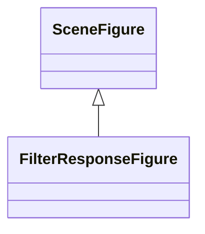

# FilterResponseFigure

**Namespace:** `mne::viz` &nbsp;·&nbsp; **Library:** Visualization Library &nbsp;·&nbsp; **Source:** [`viz/figures/filter_response_figure.h`](https://github.com/mne-tools/mne-cpp/blob/staging/src/libs/mne/viz/figures/filter_response_figure.h)

`#include <mne/viz/filter_response_figure.h>`

```cpp
class mne::viz::FilterResponseFigure
```

The magnitude response of a filter kernel in dB from 0 Hz to the Nyquist frequency, with its cut-off frequencies marked, as a [`SceneFigure`](/docs/api/viz/scene-figure).

The figure is not zoomable: it lays the [`FilterResponsePlot`](/docs/api/viz/filter-response-plot) out to the view size. `picture()` renders it at any size, e.g. to export it with `write_svg()` or `to_raster()`.

### Inheritance



---

## Public Methods

### set_filter(filter)

Shows the response of `filter`, titled with its name; filters without coefficients leave the figure as it is.

**Parameters:**

- **filter** : *const [FilterKernel](/docs/api/dsp/filter-kernel) &*
  The filter kernel.

---

### set_colors(foreground, cutoff)

**Parameters:**

- **foreground** : *[Color](/docs/api/viz/color)*
  Colour of the axes, labels and response.

- **cutoff** : *[Color](/docs/api/viz/color)*
  Colour of the cut-off markers.

---

### plot()

**Returns:**

- *const [FilterResponsePlot](/docs/api/viz/filter-response-plot) &* — The plot with the response shown.

---

### picture(width, height, metrics, font)

Renders the figure on a white picture of its own.

**Parameters:**

- **width** : *double*
  Width of the picture in pixels.

- **height** : *double*
  Height of the picture in pixels.

- **metrics** : *const [TextMetrics](/docs/api/viz/text-metrics) &*
  Metrics of the font, to lay out text.

- **font** : *const [Font](/docs/api/viz/font) &*
  Base font.

**Returns:**

- *[DisplayList](/docs/api/viz/display-list)* — The picture.

---

### bounds()

**Returns:**

- *[Rect](/docs/api/viz/rect)* — The area of the contents in scene coordinates; empty without contents.

---

### draw(canvas, metrics, font)

Draws the contents in scene coordinates; the host has already mapped them to its window.

**Parameters:**

- **canvas** : *[Canvas](/docs/api/viz/canvas) &*
  [`Canvas`](/docs/api/viz/canvas) to draw on.

- **metrics** : *const [TextMetrics](/docs/api/viz/text-metrics) &*
  Metrics of the host's fonts, to lay out text.

- **font** : *const [Font](/docs/api/viz/font) &*
  The host's base font.

---

### zoomable()

**Returns:**

- *bool* — Whether the host fits, zooms and pans the figure; otherwise it lays itself out to the view size.

---

### resize(width, height)

The view size changed; figures that are not zoomable lay themselves out to it.

**Parameters:**

- **width** : *double*
  Width of the view in pixels.

- **height** : *double*
  Height of the view in pixels.

---

## Example

No example of its own: Figure of FilterDesignPanel, shown by the panel hosts; it draws FilterResponsePlot, whose example shows the plot.

## Authors of this file

- Christoph Dinh &lt;christoph.dinh@mne-cpp.org&gt;
