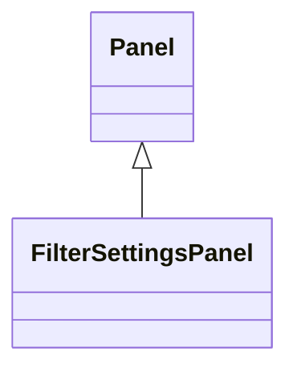

# FilterSettingsPanel

**Namespace:** `mne::viz` &nbsp;·&nbsp; **Library:** Visualization Library &nbsp;·&nbsp; **Source:** [`viz/panels/filter_settings_panel.h`](https://github.com/mne-tools/mne-cpp/blob/staging/src/libs/mne/viz/panels/filter_settings_panel.h)

`#include <mne/viz/filter_settings_panel.h>`

```cpp
class mne::viz::FilterSettingsPanel
```

Compact tool panel of filtering: whether it is active, the channel type and the pass band, with an action that asks the host to show the full [`FilterDesignPanel`](/docs/api/viz/filter-design-panel).

The panel owns its design panel. Edits of the channel type and the edges go to the design panel as if the user made them there, so its callbacks report the new kernel; the design panel's edges and channel type show here. `load()` and `save()` include the design panel's settings. In clinical mode the design action is hidden.

### Inheritance



---

## Public Methods

### FilterSettingsPanel()

Constructs the panel, inactive, with a new [`FilterDesignPanel`](/docs/api/viz/filter-design-panel).

---

### ~FilterSettingsPanel()

---

### set_callbacks(callbacks)

**Parameters:**

- **callbacks** : *Callbacks*
  What to call on changes.

---

### design()

**Returns:**

- *const std::shared_ptr&lt; [FilterDesignPanel](/docs/api/viz/filter-design-panel) &gt; &* — The design panel, for the host to show it and to set its callbacks.

---

### active()

**Returns:**

- *bool* — Whether filtering is active.

---

### set_sampling_rate(sfreq)

Limits the edges to the Nyquist frequency and designs the kernel for `sfreq`; silent.

**Parameters:**

- **sfreq** : *double*
  Sampling frequency in Hz.

---

### load(store, path)

Restores the settings of the panel and its design panel without reports.

**Parameters:**

- **store** : *const [SettingsStore](/docs/api/viz/settings-store) &*
  Settings to read.

- **path** : *const std::string &*
  Settings path of the host.

---

### save(store, path)

Stores the settings of the panel and its design panel.

**Parameters:**

- **store** : *[SettingsStore](/docs/api/viz/settings-store) &*
  Settings to write.

- **path** : *const std::string &*
  Settings path of the host.

---

## Example

No example of its own: Tool panel of the MNE Analyze filtering and MNE Scan noise reduction plugins, shown by the backends' panel hosts; works like CompensatorPanel, whose example shows the pattern.

## Authors of this file

- Christoph Dinh &lt;christoph.dinh@mne-cpp.org&gt;
