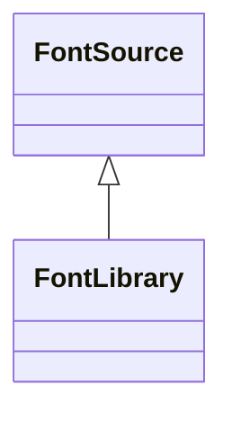

# FontLibrary

**Namespace:** `mne::viz` &nbsp;·&nbsp; **Library:** Visualization Library &nbsp;·&nbsp; **Source:** [`viz/figures/font_library.h`](https://github.com/mne-tools/mne-cpp/blob/staging/src/libs/mne/viz/figures/font_library.h)

`#include <mne/viz/font_library.h>`

```cpp
class mne::viz::FontLibrary
```

The bundled fonts as a [`FontSource`](/docs/api/viz/font-source), with installed fonts for other families and missing characters.

A [`Font`](/docs/api/viz/font) without family, or asking for "Source Sans 3", "sans-serif" or another generic sans family, is drawn in the bundled Source Sans 3, bold in its Semibold; "monospace" and "Source Code Pro" in the bundled Source Code Pro. Another family is taken from the system fonts when it is installed, else the bundled family that fits its name. A character the face lacks is taken from the other bundled faces, then from any installed face that has it, else the missing-glyph box is drawn.

```cpp title="src/examples/ex_scene/main.cpp"
// Text in the bundled Source Sans 3, laid out with the metrics of what is drawn; without RasterOptions::fonts
// the bitmap font draws, as above
const std::shared_ptr<const FontLibrary> fonts = FontLibrary::shared();
const FontTextMetrics fontMetrics(fonts);
const DisplayList typeset = plot.render(480, 320, fontMetrics, Font{"", 0.0, 13.0});
RasterOptions fontOptions;
fontOptions.fonts = fonts.get();
const Expected<void> typesetPng = to_raster(typeset, fontOptions).save_png(dir / "plot_fonts.png");
```

### Inheritance



---

## Public Methods

### FontLibrary(system)

**Parameters:**

- **system** : *std::shared_ptr&lt; const [SystemFonts](/docs/api/viz/system-fonts) &gt;*
  Installed fonts for other families and missing characters; nullptr for the bundled fonts alone, which renders identically everywhere.

---

### face(font)

**Parameters:**

- **font** : *const [Font](/docs/api/viz/font) &*
  Requested family, weight and style; the size is ignored.

**Returns:**

- *std::shared_ptr&lt; const [FontFace](/docs/api/viz/font-face) &gt;* — The face that draws `font`, or nullptr if there is none.

---

### fallback_face(font, code_point)

**Parameters:**

- **font** : *const [Font](/docs/api/viz/font) &*
  Requested font, whose `face()` lacks `code_point`.

- **code_point** : *char32_t*
  Character to draw.

**Returns:**

- *std::shared_ptr&lt; const [FontFace](/docs/api/viz/font-face) &gt;* — Another face that has a glyph for `code_point`, or nullptr to draw the missing-glyph box.

---

## Static Methods

### shared()

**Returns:**

- *std::shared_ptr&lt; const [FontLibrary](/docs/api/viz/font-library) &gt;* — The bundled fonts with `SystemFonts::shared()` as fallback, shared by the whole process.

---

### sans(semibold)

**Parameters:**

- **semibold** : *bool*
  Whether to return the Semibold face.

**Returns:**

- *std::shared_ptr&lt; const [FontFace](/docs/api/viz/font-face) &gt;* — The bundled Source Sans 3 Regular or Semibold.

---

### mono()

**Returns:**

- *std::shared_ptr&lt; const [FontFace](/docs/api/viz/font-face) &gt;* — The bundled Source Code Pro Regular.

---

### bundled_files()

The files of the bundled fonts, e.g.

for a toolkit that renders text itself (Qt registers them so its widgets use the same typefaces).

**Returns:**

- *std::vector&lt; std::span&lt; const unsigned char &gt; &gt;* — The unmodified .ttf files: Source Sans 3 Regular and Semibold, Source Code Pro Regular.

---

## Example

- Start here: [ex_scene](../../examples/viz/ex_scene.mdx) — Scene library: draw a figure on a Canvas, plot a line chart, and write both as SVG and PNG without Qt.
- Full source: [`src/examples/ex_scene/main.cpp`](https://github.com/mne-tools/mne-cpp/tree/staging/src/examples/ex_scene/main.cpp)
- Build target: `ex_scene` (runs under CTest)

## Used in examples

### [ex_scene](../../examples/viz/ex_scene.mdx)

Scene library: draw a figure on a Canvas, plot a line chart, and write both as SVG and PNG without Qt.

````cpp title="src/examples/ex_scene/main.cpp, line 203"
// Text in the bundled Source Sans 3, laid out with the metrics of what is drawn; without RasterOptions::fonts
// the bitmap font draws, as above
const std::shared_ptr<const FontLibrary> fonts = FontLibrary::shared();
const FontTextMetrics fontMetrics(fonts);
const DisplayList typeset = plot.render(480, 320, fontMetrics, Font{"", 0.0, 13.0});
RasterOptions fontOptions;
fontOptions.fonts = fonts.get();
const Expected<void> typesetPng = to_raster(typeset, fontOptions).save_png(dir / "plot_fonts.png");
// One face: glyphs, advances and pair kerning in font units
const std::shared_ptr<const FontFace> face = FontLibrary::sans();
const std::uint32_t t = face->glyph_index(U'T');
const double kerning = face->kerning(t, face->glyph_index(U'o')) * 13.0 / face->units_per_em(); // pixels at 13 px
````

## Authors of this file

- Christoph Dinh &lt;christoph.dinh@mne-cpp.org&gt;
