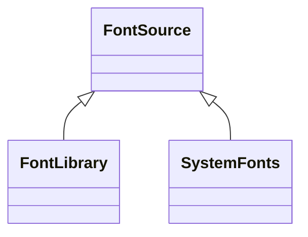

# FontSource

**Namespace:** `mne::viz` &nbsp;·&nbsp; **Library:** Visualization Library &nbsp;·&nbsp; **Source:** [`viz/figures/font_source.h`](https://github.com/mne-tools/mne-cpp/blob/staging/src/libs/mne/viz/figures/font_source.h)

`#include <mne/viz/font_source.h>`

```cpp
class mne::viz::FontSource
```

Chooses the font face that draws a [`Font`](/docs/api/viz/font), and faces for characters it lacks.

Implementations are thread-safe.

```cpp title="src/examples/ex_scene/main.cpp"
// Text in the bundled Source Sans 3, laid out with the metrics of what is drawn; without RasterOptions::fonts
// the bitmap font draws, as above
const std::shared_ptr<const FontLibrary> fonts = FontLibrary::shared();
const FontTextMetrics fontMetrics(fonts);
const DisplayList typeset = plot.render(480, 320, fontMetrics, Font{"", 0.0, 13.0});
RasterOptions fontOptions;
fontOptions.fonts = fonts.get();
const Expected<void> typesetPng = to_raster(typeset, fontOptions).save_png(dir / "plot_fonts.png");
```

### Inheritance



---

## Public Methods

### ~FontSource()

---

### face(font)

**Parameters:**

- **font** : *const [Font](/docs/api/viz/font) &*
  Requested family, weight and style; the size is ignored.

**Returns:**

- *std::shared_ptr&lt; const [FontFace](/docs/api/viz/font-face) &gt;* — The face that draws `font`, or nullptr if there is none.

---

### fallback_face(font, code_point)

**Parameters:**

- **font** : *const [Font](/docs/api/viz/font) &*
  Requested font, whose `face()` lacks `code_point`.

- **code_point** : *char32_t*
  Character to draw.

**Returns:**

- *std::shared_ptr&lt; const [FontFace](/docs/api/viz/font-face) &gt;* — Another face that has a glyph for `code_point`, or nullptr to draw the missing-glyph box.

---

## Example

- Start here: [ex_scene](../../examples/viz/ex_scene.mdx) — Scene library: draw a figure on a Canvas, plot a line chart, and write both as SVG and PNG without Qt.
- Full source: [`src/examples/ex_scene/main.cpp`](https://github.com/mne-tools/mne-cpp/tree/staging/src/examples/ex_scene/main.cpp)
- Build target: `ex_scene` (runs under CTest)

## Authors of this file

- Christoph Dinh &lt;christoph.dinh@mne-cpp.org&gt;
