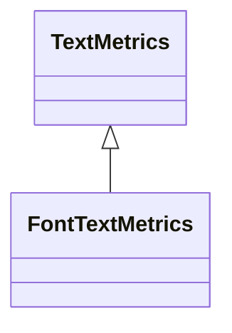

# FontTextMetrics

**Namespace:** `mne::viz` &nbsp;·&nbsp; **Library:** Visualization Library &nbsp;·&nbsp; **Source:** [`viz/figures/font_text_metrics.h`](https://github.com/mne-tools/mne-cpp/blob/staging/src/libs/mne/viz/figures/font_text_metrics.h)

`#include <mne/viz/font_text_metrics.h>`

```cpp
class mne::viz::FontTextMetrics
```

Text metrics of real fonts: the layouts of views match the text the software renderer draws with the same [`FontSource`](/docs/api/viz/font-source) (`RasterOptions::fonts`, `SoftwareRenderer::set_fonts()`).

Advances are fractional and include kerning; ascent and descent are whole pixels. Fonts the source has no face for are measured like [`ApproximateTextMetrics`](/docs/api/viz/approximate-text-metrics).

```cpp title="src/examples/ex_scene/main.cpp"
// Text in the bundled Source Sans 3, laid out with the metrics of what is drawn; without RasterOptions::fonts
// the bitmap font draws, as above
const std::shared_ptr<const FontLibrary> fonts = FontLibrary::shared();
const FontTextMetrics fontMetrics(fonts);
const DisplayList typeset = plot.render(480, 320, fontMetrics, Font{"", 0.0, 13.0});
RasterOptions fontOptions;
fontOptions.fonts = fonts.get();
const Expected<void> typesetPng = to_raster(typeset, fontOptions).save_png(dir / "plot_fonts.png");
```

### Inheritance



---

## Public Methods

### FontTextMetrics(fonts, default_pixel_size)

**Parameters:**

- **fonts** : *std::shared_ptr&lt; const [FontSource](/docs/api/viz/font-source) &gt;*
  Source of the faces, e.g. `FontLibrary::shared()`.

- **default_pixel_size** : *double*
  Pixel size of a font without size.

---

### pixel_size(font)

**Parameters:**

- **font** : *const [Font](/docs/api/viz/font) &*
  [`Font`](/docs/api/viz/font) of the text.

**Returns:**

- *double* — The font size in pixels.

---

### advance(font, text)

**Parameters:**

- **font** : *const [Font](/docs/api/viz/font) &*
  [`Font`](/docs/api/viz/font) of the text.

- **text** : *std::string_view*
  UTF-8 text.

**Returns:**

- *double* — The width of `text` in `font`, in pixels.

---

### ascent(font)

**Parameters:**

- **font** : *const [Font](/docs/api/viz/font) &*
  [`Font`](/docs/api/viz/font) of the text.

**Returns:**

- *double* — The distance from the baseline to the top of the tallest glyphs.

---

### descent(font)

**Parameters:**

- **font** : *const [Font](/docs/api/viz/font) &*
  [`Font`](/docs/api/viz/font) of the text.

**Returns:**

- *double* — The distance from the baseline to the bottom of the lowest glyphs.

---

## Example

- Start here: [ex_scene](../../examples/viz/ex_scene.mdx) — Scene library: draw a figure on a Canvas, plot a line chart, and write both as SVG and PNG without Qt.
- Full source: [`src/examples/ex_scene/main.cpp`](https://github.com/mne-tools/mne-cpp/tree/staging/src/examples/ex_scene/main.cpp)
- Build target: `ex_scene` (runs under CTest)

## Used in examples

### [ex_scene](../../examples/viz/ex_scene.mdx)

Scene library: draw a figure on a Canvas, plot a line chart, and write both as SVG and PNG without Qt.

````cpp title="src/examples/ex_scene/main.cpp, line 203"
// Text in the bundled Source Sans 3, laid out with the metrics of what is drawn; without RasterOptions::fonts
// the bitmap font draws, as above
const std::shared_ptr<const FontLibrary> fonts = FontLibrary::shared();
const FontTextMetrics fontMetrics(fonts);
const DisplayList typeset = plot.render(480, 320, fontMetrics, Font{"", 0.0, 13.0});
RasterOptions fontOptions;
fontOptions.fonts = fonts.get();
const Expected<void> typesetPng = to_raster(typeset, fontOptions).save_png(dir / "plot_fonts.png");
// One face: glyphs, advances and pair kerning in font units
const std::shared_ptr<const FontFace> face = FontLibrary::sans();
const std::uint32_t t = face->glyph_index(U'T');
const double kerning = face->kerning(t, face->glyph_index(U'o')) * 13.0 / face->units_per_em(); // pixels at 13 px
````

### [ex_scene_sdl](../../examples/viz/ex_scene_sdl.mdx)

Trace view in an SDL3 window, without Qt: mne_scene's view and software renderer in another toolkit.

````cpp title="src/examples/ex_scene_sdl/main.cpp, line 292"
// The layouts measure the text with the fonts the host draws it with
const FontTextMetrics metrics(options.fonts);
````

## Authors of this file

- Christoph Dinh &lt;christoph.dinh@mne-cpp.org&gt;
