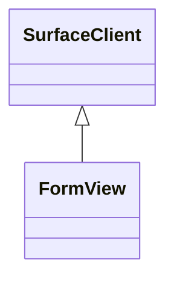

# FormView

**Namespace:** `mne::viz` &nbsp;·&nbsp; **Library:** Visualization Library &nbsp;·&nbsp; **Source:** [`viz/panels/form_view.h`](https://github.com/mne-tools/mne-cpp/blob/staging/src/libs/mne/viz/panels/form_view.h)

`#include <mne/viz/form_view.h>`

```cpp
class mne::viz::FormView
```

Shows and edits a [`SettingsForm`](/docs/api/viz/settings-form) in a [`Surface`](/docs/api/viz/surface), drawn toolkit-free in the look of a [`Theme`](/docs/api/viz/theme).

The title of the form comes first, then each group as a card with one row per visible field: the label on the left, the editor on the right. Bool fields are switches, numbers steppers with - and + buttons (the wheel steps too), choices cycle with &lt; and &gt; buttons, text, path and directory fields are line edits, actions buttons, colours swatches and info fields toned text. Disabled fields are greyed and ignore input. The view follows the form: it lays out again when fields are added, removed or relabelled and repaints when values change. Content taller than the surface scrolls with the wheel.

The form must outlive the view.

```cpp title="src/examples/ex_scene_sdl/main.cpp"
std::unique_ptr<Panel> panel;
if (which == "compensator") {
    auto compensator = std::make_unique<CompensatorPanel>();
    std::vector<mne::FiffCtfComp> comps(3);
    for (int i = 0; i < 3; ++i) {
        comps[static_cast<std::size_t>(i)].kind = i + 1;
    }
    compensator->set_compensators(comps);
    compensator->set_selection_callback([](int to) {
        std::printf("Compensation grade %d\n", to);
    });
    panel = std::move(compensator);
} else {
    auto projectors = std::make_unique<ProjectorsPanel>();
    std::vector<mne::FiffProj> projs(4);
    const char* descriptions[] = {"Average EEG reference", "PCA-v1 (planar)", "PCA-v2 (axial)", "ECG-planar-999--0.200-0.400-PCA-01"};
    for (std::size_t i = 0; i < projs.size(); ++i) {
        projs[i].desc = descriptions[i];
        projs[i].active = i != 2;
    }
    projectors->set_projectors(projs);
    projectors->set_selection_callback([](const std::vector<mne::FiffProj>& selected) {
        std::printf("Projectors:");
        for (const mne::FiffProj& proj : selected) {
            std::printf(" %d", proj.active ? 1 : 0);
        }
        std::printf("\n");
    });
    panel = std::move(projectors);
}
FormView view(*panel);
return host.run(view);
```

### Inheritance



---

## Public Methods

### FormView(form, theme)

Shows a form.

**Parameters:**

- **form** : *[SettingsForm](/docs/api/viz/settings-form) &*
  The form; it outlives the view.

- **theme** : *[Theme](/docs/api/viz/theme)*
  The look.

---

### FormView(panel, theme)

Shows the form of a panel.

**Parameters:**

- **panel** : *[Panel](/docs/api/viz/panel) &*
  The panel; it outlives the view.

- **theme** : *[Theme](/docs/api/viz/theme)*
  The look.

---

### ~FormView()

Destroys the view and stops listening to the form.

---

### FormView()

---

### operator=()

---

### form()

**Returns:**

- *[SettingsForm](/docs/api/viz/settings-form) &* — The form shown.

---

### theme()

**Returns:**

- *const [Theme](/docs/api/viz/theme) &* — The look.

---

### set_theme(theme)

Changes the look.

**Parameters:**

- **theme** : *[Theme](/docs/api/viz/theme)*
  The new look.

---

### set_text_metrics(metrics)

Measures text with other metrics, e.g.

those of the backend's fonts.

**Parameters:**

- **metrics** : *const [TextMetrics](/docs/api/viz/text-metrics) **
  The metrics, outliving the view, or nullptr for [`ApproximateTextMetrics`](/docs/api/viz/approximate-text-metrics).

---

### set_view_size(width, height)

Sets the size of the view; `resize()` does so for hosted views.

**Parameters:**

- **width** : *double*
  Width in logical units.

- **height** : *double*
  Height in logical units.

---

### content_height()

**Returns:**

- *double* — Height of the laid-out content in logical units.

---

### scroll_offset()

**Returns:**

- *double* — How far the content is scrolled up, in logical units.

---

### set_scroll_offset(offset)

Scrolls the content, clamped so it stays in view.

**Parameters:**

- **offset** : *double*
  How far the content is scrolled up, in logical units.

---

### editor_rect(key, part)

**Parameters:**

- **key** : *const std::string &*
  `Key` of a field.

- **part** : *Part*
  `Part` of its editor.

**Returns:**

- *std::optional&lt; [Rect](/docs/api/viz/rect) &gt;* — Where the part is shown in view coordinates (scrolling applied), or nothing if the field is not shown or its editor has no such part.

---

### focused_key()

**Returns:**

- *const std::string &* — `Key` of the text field being edited, or an empty string.

---

### edit_text()

**Returns:**

- *const std::string &* — The text of the field being edited, including uncommitted changes.

---

### draw()

Draws the view as it is now.

**Returns:**

- *[DisplayList](/docs/api/viz/display-list)* — The figure of the view's logical size.

---

### resize(size)

The surface changed its size.

**Parameters:**

- **size** : *const [SurfaceSize](/docs/api/viz/surface-size) &*
  The new size.

---

### handle_pointer(event)

A pointer pressed, moved, released or double-clicked over the surface.

**Parameters:**

- **event** : *const [PointerEvent](/docs/api/viz/pointer-event) &*
  The pointer event.

**Returns:**

- *bool* — Whether the client used the event.

---

### handle_wheel(event)

The wheel turned or the touchpad scrolled over the surface.

**Parameters:**

- **event** : *const [WheelEvent](/docs/api/viz/wheel-event) &*
  The wheel event.

**Returns:**

- *bool* — Whether the client used the event.

---

### handle_key(event)

A key was pressed while the surface had the focus.

**Parameters:**

- **event** : *const [KeyEvent](/docs/api/viz/key-event) &*
  The key event.

**Returns:**

- *bool* — Whether the client used the event.

---

### frame(target)

Describes the next frame.

**Parameters:**

- **target** : *const [GpuFrameTarget](/docs/api/viz/gpu-frame-target) &*
  Pixel size and clip-space correction of the host's render target.

**Returns:**

- *[GpuFrame](/docs/api/viz/gpu-frame)* — The frame, referring to `resources()`.

---

### resources()

**Returns:**

- *const [GpuResources](/docs/api/viz/gpu-resources) &* — Buffers, textures and pipelines the frames refer to.

---

## Example

- Start here: [ex_scene_sdl](../../examples/viz/ex_scene_sdl.mdx) — Trace view in an SDL3 window, without Qt: mne_scene's view and software renderer in another toolkit.
- Full source: [`src/examples/ex_scene_sdl/main.cpp`](https://github.com/mne-tools/mne-cpp/tree/staging/src/examples/ex_scene_sdl/main.cpp)
- Build target: `ex_scene_sdl` (runs under CTest)

## Used in examples

### [ex_scene_sdl](../../examples/viz/ex_scene_sdl.mdx)

Trace view in an SDL3 window, without Qt: mne_scene's view and software renderer in another toolkit.

````cpp title="src/examples/ex_scene_sdl/main.cpp, line 133"
    FormView view(*panel);
    return host.run(view);
}
````

## Authors of this file

- Christoph Dinh &lt;christoph.dinh@mne-cpp.org&gt;
