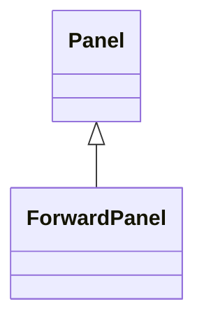

# ForwardPanel

**Namespace:** `mne::viz` &nbsp;·&nbsp; **Library:** Visualization Library &nbsp;·&nbsp; **Source:** [`viz/panels/forward_panel.h`](https://github.com/mne-tools/mne-cpp/blob/staging/src/libs/mne/viz/panels/forward_panel.h)

`#include <mne/viz/forward_panel.h>`

```cpp
class mne::viz::ForwardPanel
```

Controls and status of the forward solution: computation, head position updates, clustering with a brain atlas, and a summary of the solution.

Clustering needs the a2009s annotations of both hemispheres in the atlas directory; without them the clustering switch turns off again and the atlas status asks for them.

### Inheritance



---

## Public Methods

### ForwardPanel(atlasDirectory)

**Parameters:**

- **atlasDirectory** : *const std::filesystem::path &*
  Directory with the a2009s annotations loaded at start, e.g. the sample subject's label directory; empty for none.

---

### ~ForwardPanel()

---

### set_callbacks(callbacks)

**Parameters:**

- **callbacks** : *Callbacks*
  What the panel reports.

---

### set_atlas_directory(directory, notify)

Loads the a2009s annotations of an atlas directory and reports them when both hemispheres load.

**Parameters:**

- **directory** : *const std::filesystem::path &*
  Atlas directory.

- **notify** : *bool*
  Whether to call `Callbacks::atlas_changed`.

**Returns:**

- *bool* — Whether both annotations loaded.

---

### atlas_loaded()

**Returns:**

- *bool* — Whether the atlas annotations are loaded.

---

### set_status(status)

Shows the state of the computation.

**Parameters:**

- **status** : *int*
  State; values beyond Finished show as Finished.

---

### set_solution_information(sourceOri, coordFrame, sources, channels, spaces)

Shows a summary of a computed solution.

**Parameters:**

- **sourceOri** : *mne::fiff_int_t*
  Source orientation: 0 fixed, else free.

- **coordFrame** : *mne::fiff_int_t*
  Coordinate frame (FIFFV_COORD_*).

- **sources** : *int*
  Number of sources.

- **channels** : *int*
  Number of channels.

- **spaces** : *int*
  Number of source spaces.

---

### set_clustered_information(sources)

Shows the number of sources after clustering.

**Parameters:**

- **sources** : *int*
  Number of clustered sources.

---

### recomputation()

**Returns:**

- *bool* — Whether head position updates recompute the solution.

---

### clustering()

**Returns:**

- *bool* — Whether the solution is clustered.

---

### cluster_sources()

**Returns:**

- *int* — The number of sources per cluster.

---

## Example

No example of its own: Tool panel of the MNE Scan forward plugin, shown by the backends' panel hosts; works like CompensatorPanel, whose example shows the pattern.

## Authors of this file

- Christoph Dinh &lt;christoph.dinh@mne-cpp.org&gt;
