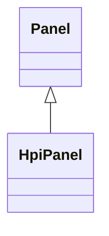

# HpiPanel

**Namespace:** `mne::viz` &nbsp;·&nbsp; **Library:** Visualization Library &nbsp;·&nbsp; **Source:** [`viz/panels/hpi_panel.h`](https://github.com/mne-tools/mne-cpp/blob/staging/src/libs/mne/viz/panels/hpi_panel.h)

`#include <mne/viz/hpi_panel.h>`

```cpp
class mne::viz::HpiPanel
```

Tool panel of the HPI fitting: the digitizers with the HPI coils, the coil frequencies (typed or from a preset), the fitting options, and the fit errors, goodness of fit and head movement.

The coil frequencies are a comma-separated list in Hz; "none" marks a coil without a frequency. The coil frequencies, the SSP, compensator and continuous fitting switches, the error threshold and the fitting window are stored under "&lt;path&gt;/HpiSettingsView/&lt;key&gt;" and restored without reports. Programmatic changes are not reported; the user's are.

### Inheritance



---

## Public Methods

### HpiPanel()

Creates the panel with the Neuromag VectorView presets and four coils at 293, 307, 314 and 321 Hz.

---

### ~HpiPanel()

---

### set_callbacks(callbacks)

**Parameters:**

- **callbacks** : *Callbacks*
  What the panel reports.

---

### set_errors(errors, meanError)

Shows the fit error of each coil and their mean, and whether the fit is good.

**Parameters:**

- **errors** : *const std::vector&lt; double &gt; &*
  [`Error`](/docs/api/base/error) of each coil in m.

- **meanError** : *double*
  Mean error in m; above the error threshold the fit is bad.

---

### set_goodness_of_fit(goodness, meanGoodness)

Shows the goodness of fit of each coil and their mean.

**Parameters:**

- **goodness** : *const Eigen::VectorXd &*
  Goodness of fit of each coil, 0 to 1.

- **meanGoodness** : *double*
  Mean goodness of fit.

---

### set_movement(movement, rotation)

Shows the head movement since the last reference position and whether it is big.

**Parameters:**

- **movement** : *double*
  Movement in m.

- **rotation** : *double*
  Rotation in degrees.

---

### set_digitizers(digitizers)

Shows the digitizers: the number of points of each kind, one coil per HPI point, and the presets for that number of coils.

**Parameters:**

- **digitizers** : *const [FiffDigPointSet](/docs/api/fiff/fiff-dig-point-set) &*
  The digitizer points.

---

### load_digitizers(file)

Loads the digitizers of a FIFF file as the user does, reporting them and stopping continuous fitting.

**Parameters:**

- **file** : *const std::filesystem::path &*
  The FIFF file.

**Returns:**

- *bool* — Whether digitizers were loaded.

---

### load_coil_presets(file)

Replaces the coil presets, by default the Neuromag VectorView frequencies, with those of a JSON file: an object mapping the number of coils ("4", "5", ...) to an array of \{"name": ..., "coils": [Hz, ...]\}.

**Parameters:**

- **file** : *const std::filesystem::path &*
  The JSON file.

**Returns:**

- *bool* — Whether the file could be read and parsed; if not, the presets are left unchanged.

---

### set_coil_frequencies(frequencies)

Sets the coil frequencies.

**Parameters:**

- **frequencies** : *const std::vector&lt; int &gt; &*
  Frequencies in Hz, -1 for a coil without a frequency.

---

### coil_frequencies()

**Returns:**

- *const std::vector&lt; int &gt; &* — The coil frequencies in Hz, -1 for a coil without a frequency.

---

### coil_presets()

**Returns:**

- *std::vector&lt; std::string &gt;* — The names of the coil presets for the current number of coils.

---

### use_ssp()

**Returns:**

- *bool* — Whether SSP is applied.

---

### use_compensators()

**Returns:**

- *bool* — Whether the compensators are applied.

---

### continuous_fitting()

**Returns:**

- *bool* — Whether the head position is fitted continuously.

---

### fitting_window_size()

**Returns:**

- *int* — The fitting window in samples.

---

### allowed_error()

**Returns:**

- *double* — The allowed mean error in mm.

---

### allowed_movement()

**Returns:**

- *double* — The allowed head movement in mm.

---

### allowed_rotation()

**Returns:**

- *double* — The allowed head rotation in degrees.

---

### load(store, path)

Restores the panel without reports; a stored list without valid frequencies keeps the current one.

**Parameters:**

- **store** : *const [SettingsStore](/docs/api/viz/settings-store) &*
  Stored settings.

- **path** : *const std::string &*
  Settings path of the host; empty restores nothing.

---

## Static Methods

### parse_frequencies(text)

Parses a comma- or space-separated list of coil frequencies.

**Parameters:**

- **text** : *const std::string &*
  The list, e.g. "293, 307, none, 321".

**Returns:**

- *std::vector&lt; int &gt;* — The frequencies in Hz, -1 for each entry that is no positive number.

---

### format_frequencies(frequencies)

**Parameters:**

- **frequencies** : *const std::vector&lt; int &gt; &*
  Frequencies in Hz, -1 for none.

**Returns:**

- *std::string* — The frequencies as the panel shows them, e.g. "293, 307, none, 321".

---

## Example

No example of its own: Tool panel of an MNE Scan or MNE Analyze plugin, shown by the backends' panel hosts; works like CompensatorPanel, whose example shows the pattern.

## Authors of this file

- Christoph Dinh &lt;christoph.dinh@mne-cpp.org&gt;
