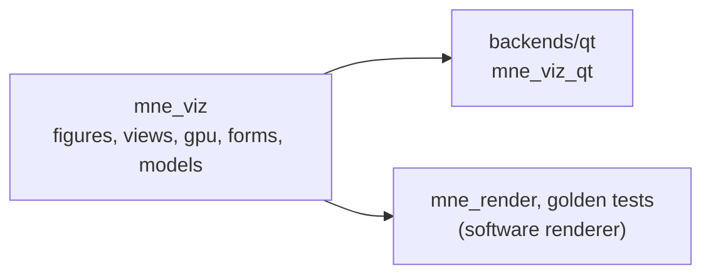

# Visualization Library

**Namespace:** `mne::viz` &nbsp;·&nbsp; **Source:** `src/libs/mne/viz`
`mne_viz` (namespace `mne::viz`, `src/libs/mne/viz`) describes what the MNE-CPP viewers show and how they behave, without a GUI toolkit or a GPU. Backends under `src/libs/mne/viz/backends/` render and host it; [`mne_viz_qt`](../viz-qt/index.mdx) is the Qt backend.

| Folder | Contents |
|---|---|
| `figures/` | Figures as display lists (`Canvas`, line, bar, butterfly, image, spline and vector plots, sensor and average layouts, ticks, colour maps), rendered to SVG (`SvgRenderer`) or images (`RasterRenderer`) |
| `views/` | The logic of the interactive views: `TraceView` with its buffers, geometry, markers and animation, the brain view's `OrbitCamera`, picking, pane layout, interaction and overlay, and toolkit-neutral input events |
| `gpu/` | `GpuFrame`, a backend-neutral description of a GPU frame (buffers, pipelines, draw calls); `TraceFrameBuilder` and `BrainFrameBuilder` produce it and the built-in `SoftwareRenderer` executes it headless |
| `forms/` | `SettingsForm`, the description of a settings panel from which a backend builds its widgets |
| `models/` | View models: `ChannelTable`, `SpectrumTable`, `BidsTree`, evoked conditions |



A backend depends on `mne_viz` only, never on another backend, and `mne_viz` never includes from `backends/`; the dependency audit enforces both. Only the Qt backend uses Qt.

```cmake
target_link_libraries(my_tool PRIVATE mne_viz)
```
