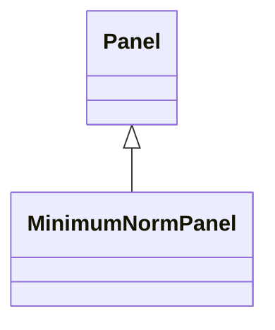

# MinimumNormPanel

**Namespace:** `mne::viz` &nbsp;·&nbsp; **Library:** Visualization Library &nbsp;·&nbsp; **Source:** [`viz/panels/minimum_norm_panel.h`](https://github.com/mne-tools/mne-cpp/blob/staging/src/libs/mne/viz/panels/minimum_norm_panel.h)

`#include <mne/viz/minimum_norm_panel.h>`

```cpp
class mne::viz::MinimumNormPanel
```

Tool panel of the minimum-norm source estimation: the method (MNE, dSPM, sLORETA or CMNE), the trigger type and time point of the averages, and for CMNE the ONNX model checkpoint.

A method given to the constructor is fixed. Only the checkpoint is stored, under "&lt;path&gt;/MinimumNormSettingsView/
modelCheckpoint".

### Inheritance



---

## Public Methods

### MinimumNormPanel(method)

**Parameters:**

- **method** : *const std::string &*
  A fixed method, or empty to let the user choose.

---

### ~MinimumNormPanel()

---

### set_callbacks(callbacks)

**Parameters:**

- **callbacks** : *Callbacks*
  What to call on changes.

---

### set_trigger_types(types)

Adds trigger types the panel does not offer yet.

**Parameters:**

- **types** : *const std::vector&lt; std::string &gt; &*
  Trigger types.

---

### set_model_checkpoint(path)

**Parameters:**

- **path** : *const std::filesystem::path &*
  The CMNE checkpoint; reported if it changed.

---

### model_checkpoint()

**Returns:**

- *std::filesystem::path* — The CMNE checkpoint.

---

### method()

**Returns:**

- *std::string* — The method.

---

## Example

No example of its own: Tool panel of an MNE Scan plugin, shown by the backends' panel hosts; works like CompensatorPanel, whose example shows the pattern.

## Authors of this file

- Christoph Dinh &lt;christoph.dinh@mne-cpp.org&gt;
