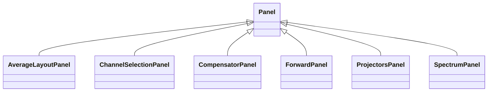

# Panel

**Namespace:** `mne::viz` &nbsp;·&nbsp; **Library:** Visualization Library &nbsp;·&nbsp; **Source:** [`viz/panels/panel.h`](https://github.com/mne-tools/mne-cpp/blob/staging/src/libs/mne/viz/panels/panel.h)

`#include <mne/viz/panel.h>`

```cpp
class mne::viz::Panel
```

Base of the toolkit-free tool panels: a title, a settings form with item lists, an optional figure, modes and persistence.

```cpp title="src/examples/ex_scene/main.cpp"
// A tool panel holds its state and rules once; every backend shows it with one generic host
// (viz::qt::PanelWidget for Qt) and stores it through a SettingsStore
std::vector<mne::FiffCtfComp> comps(2);
comps[0].kind = 1;
comps[1].kind = 3;
CompensatorPanel compensators;
int grade = -1;
compensators.set_selection_callback([&grade](int to) {
    grade = to;
});
compensators.set_compensators(comps);
compensators.form().set_value(CompensatorPanel::field_key(3), true);
MemorySettingsStore settings;
compensators.save(settings, "ex_scene");
```

### Inheritance



---

## Public Methods

### Panel(id, title)

**Parameters:**

- **id** : *std::string*
  Settings group of the panel, e.g. "CompensatorView".

- **title** : *std::string*
  Window title.

---

### ~Panel()

---

### Panel()

---

### operator=()

---

### id()

**Returns:**

- *const std::string &* — The settings group of the panel.

---

### title()

**Returns:**

- *const std::string &* — The window title.

---

### form()

**Returns:**

- *[SettingsForm](/docs/api/viz/settings-form) &* — The controls of the panel.

---

### form()

**Returns:**

- *const [SettingsForm](/docs/api/viz/settings-form) &* — The controls of the panel.

---

### shared_form()

**Returns:**

- *const std::shared_ptr&lt; [SettingsForm](/docs/api/viz/settings-form) &gt; &* — The form, shared with hosts that may outlive the panel's owner.

---

### width()

**Returns:**

- *int* — The width hosts give the panel in logical pixels; 0 for any.

---

### set_gui_mode(mode)

Sets who uses the application; panels hide or show options.

**Parameters:**

- **mode** : *GuiMode*
  New mode.

---

### gui_mode()

**Returns:**

- *GuiMode* — Who uses the application.

---

### set_processing_mode(mode)

Sets how the data arrive; panels hide or show options.

**Parameters:**

- **mode** : *ProcessingMode*
  New mode.

---

### processing_mode()

**Returns:**

- *ProcessingMode* — How the data arrive.

---

### figure()

**Returns:**

- *const std::shared_ptr&lt; [SceneFigure](/docs/api/viz/scene-figure) &gt; &* — The interactive figure that hosts show below the form, or null for panels with only a form.

---

### lists()

**Returns:**

- *const std::map&lt; std::string, std::shared_ptr&lt; [ItemList](/docs/api/viz/item-list) &gt; &gt; &* — The item lists by key; each sits in the custom field of its key, where hosts show it.

---

### list(key)

**Parameters:**

- **key** : *const std::string &*
  `Key` of a list.

**Returns:**

- *[ItemList](/docs/api/viz/item-list) ** — The list, or null.

---

### load(store, path)

Restores the panel from `store`.

By default the persistent form fields are read from "&lt;path&gt;/&lt;id&gt;/&lt;field key&gt;".

**Parameters:**

- **store** : *const [SettingsStore](/docs/api/viz/settings-store) &*
  Stored settings.

- **path** : *const std::string &*
  Settings path of the host, e.g. "MNESCAN/NoiseReduction"; empty restores nothing.

---

### save(store, path)

Stores the panel in `store`, under the keys `load()` reads.

**Parameters:**

- **store** : *[SettingsStore](/docs/api/viz/settings-store) &*
  Stored settings.

- **path** : *const std::string &*
  Settings path of the host; empty stores nothing.

---

## Example

- Start here: [ex_scene](../../examples/viz/ex_scene.mdx) — Scene library: draw a figure on a Canvas, plot a line chart, and write both as SVG and PNG without Qt.
- Full source: [`src/examples/ex_scene/main.cpp`](https://github.com/mne-tools/mne-cpp/tree/staging/src/examples/ex_scene/main.cpp)
- Build target: `ex_scene` (runs under CTest)

## Used in examples

### [ex_scene_sdl](../../examples/viz/ex_scene_sdl.mdx)

Trace view in an SDL3 window, without Qt: mne_scene's view and software renderer in another toolkit.

````cpp title="src/examples/ex_scene_sdl/main.cpp, line 260"
std::unique_ptr<Panel> panel;
if (which == "compensator") {
    auto compensator = std::make_unique<CompensatorPanel>();
    std::vector<mne::FiffCtfComp> comps(3);
    for (int i = 0; i < 3; ++i) {
        comps[static_cast<std::size_t>(i)].kind = i + 1;
    }
    compensator->set_compensators(comps);
    compensator->set_selection_callback([](int to) {
        std::printf("Compensation grade %d\n", to);
    });
    panel = std::move(compensator);
} else {
    auto projectors = std::make_unique<ProjectorsPanel>();
````

## Authors of this file

- Christoph Dinh &lt;christoph.dinh@mne-cpp.org&gt;
