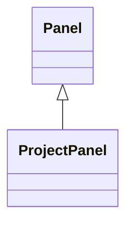

# ProjectPanel

**Namespace:** `mne::viz` &nbsp;·&nbsp; **Library:** Visualization Library &nbsp;·&nbsp; **Source:** [`viz/panels/project_panel.h`](https://github.com/mne-tools/mne-cpp/blob/staging/src/libs/mne/viz/panels/project_panel.h)

`#include <mne/viz/project_panel.h>`

```cpp
class mne::viz::ProjectPanel
```

Tool panel of a recording: the data directory with its projects and subjects as directories, the paradigm, the resulting file name "&lt;directory&gt;/&lt;project&gt;/&lt;subject&gt;/&lt;YYMMDD_HHMMSS&gt;_&lt;subject&gt;[_&lt;paradigm&gt;]_raw.fif" and the recording timer.

New projects and subjects are created as directories. Programmatic changes are not reported; the user's are. Nothing is stored.

### Inheritance



---

## Public Methods

### ProjectPanel(dataDirectory, project, subject, paradigm)

**Parameters:**

- **dataDirectory** : *const std::filesystem::path &*
  Directory holding the projects.

- **project** : *const std::string &*
  Project chosen at start.

- **subject** : *const std::string &*
  Subject chosen at start.

- **paradigm** : *const std::string &*
  Paradigm at start; empty for none.

---

### ~ProjectPanel()

---

### set_callbacks(callbacks)

**Parameters:**

- **callbacks** : *Callbacks*
  What the panel reports.

---

### set_recording_elapsed_time(milliseconds)

Shows the time passed since the recording started.

**Parameters:**

- **milliseconds** : *int*
  Elapsed time; within half a second of the recording time it shows the recording time.

---

### current_file_name()

Updates the file name with the current time.

**Returns:**

- *std::string* — The file name.

---

### set_file_name_visible(visible)

Shows or hides the file name.

**Parameters:**

- **visible** : *bool*
  Whether the file name is shown.

---

### set_paradigm_visible(visible)

Shows or hides the paradigm.

**Parameters:**

- **visible** : *bool*
  Whether the paradigm is shown.

---

### add_project(name)

Creates a project directory and chooses it, as the user does with "Add project".

**Parameters:**

- **name** : *const std::string &*
  Name of the project.

**Returns:**

- *bool* — Whether the project exists afterwards.

---

### add_subject(name)

Creates a subject directory in the current project and chooses it, as the user does with "Add subject".

**Parameters:**

- **name** : *const std::string &*
  Name of the subject.

**Returns:**

- *bool* — Whether the subject exists afterwards.

---

### data_directory()

**Returns:**

- *std::filesystem::path* — The directory holding the projects.

---

### projects()

**Returns:**

- *std::vector&lt; std::string &gt;* — The projects found in the data directory, sorted by name ignoring case.

---

### subjects()

**Returns:**

- *std::vector&lt; std::string &gt;* — The subjects found in the current project, sorted by name ignoring case.

---

### project()

**Returns:**

- *const std::string &* — The current project.

---

### subject()

**Returns:**

- *const std::string &* — The current subject.

---

### paradigm()

**Returns:**

- *std::string* — The paradigm; empty for none.

---

### file_name()

**Returns:**

- *const std::string &* — The file name as last updated.

---

### recording_time()

**Returns:**

- *int* — The recording time in milliseconds.

---

### recording_timer()

**Returns:**

- *bool* — Whether the recording timer is on.

---

## Example

No example of its own: Tool panel of an MNE Scan or MNE Analyze plugin, shown by the backends' panel hosts; works like CompensatorPanel, whose example shows the pattern.

## Authors of this file

- Christoph Dinh &lt;christoph.dinh@mne-cpp.org&gt;
