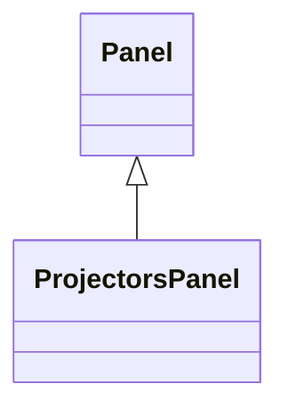

# ProjectorsPanel

**Namespace:** `mne::viz` &nbsp;·&nbsp; **Library:** Visualization Library &nbsp;·&nbsp; **Source:** [`viz/panels/projectors_panel.h`](https://github.com/mne-tools/mne-cpp/blob/staging/src/libs/mne/viz/panels/projectors_panel.h)

`#include <mne/viz/projectors_panel.h>`

```cpp
class mne::viz::ProjectorsPanel
```

One check box per projector and one that switches all of them.

The state of each projector is remembered by its description across sessions under "&lt;path&gt;/ProjectorsView/active".

### Inheritance



---

## Public Methods

### ProjectorsPanel()

---

### ~ProjectorsPanel()

---

### set_projectors(projs)

Shows the projectors of the data with their remembered states, and reports them.

**Parameters:**

- **projs** : *const std::vector&lt; [FiffProj](/docs/api/fiff/fiff-proj) &gt; &*
  Projectors of the measurement info.

---

### projectors()

**Returns:**

- *const std::vector&lt; [FiffProj](/docs/api/fiff/fiff-proj) &gt; &* — The projectors with their current active flags.

---

### set_active(index, active)

Switches a projector, as a click on its check box does.

**Parameters:**

- **index** : *std::size_t*
  Index into `projectors()`.

- **active** : *bool*
  New state.

---

### set_all_active(active)

Switches all projectors.

**Parameters:**

- **active** : *bool*
  New state.

---

### set_selection_callback(callback)

**Parameters:**

- **callback** : *SelectionCallback*
  Called whenever a projector is switched.

---

### load(store, path)

Restores the panel from `store`.

By default the persistent form fields are read from "&lt;path&gt;/&lt;id&gt;/&lt;field key&gt;".

**Parameters:**

- **store** : *const [SettingsStore](/docs/api/viz/settings-store) &*
  Stored settings.

- **path** : *const std::string &*
  Settings path of the host, e.g. "MNESCAN/NoiseReduction"; empty restores nothing.

---

### save(store, path)

Stores the panel in `store`, under the keys `load()` reads.

**Parameters:**

- **store** : *[SettingsStore](/docs/api/viz/settings-store) &*
  Stored settings.

- **path** : *const std::string &*
  Settings path of the host; empty stores nothing.

---

## Static Methods

### field_key(index)

**Parameters:**

- **index** : *std::size_t*
  Index into `projectors()`.

**Returns:**

- *std::string* — The form key of the check box of the projector.

---

## Example

No example of its own: Tool panel shown by the backends' panel hosts in MNE Scan; works like CompensatorPanel, whose example shows the pattern.

## Used in examples

### [ex_scene_sdl](../../examples/viz/ex_scene_sdl.mdx)

Trace view in an SDL3 window, without Qt: mne_scene's view and software renderer in another toolkit.

````cpp title="src/examples/ex_scene_sdl/main.cpp, line 190"
auto projectors = std::make_unique<ProjectorsPanel>();
std::vector<mne::FiffProj> projs(4);
const char* descriptions[] = {"Average EEG reference", "PCA-v1 (planar)", "PCA-v2 (axial)", "ECG-planar-999--0.200-0.400-PCA-01"};
for (std::size_t i = 0; i < projs.size(); ++i) {
    projs[i].desc = descriptions[i];
    projs[i].active = i != 2;
}
projectors->set_projectors(projs);
projectors->set_selection_callback([](const std::vector<mne::FiffProj>& selected) {
    std::printf("Projectors:");
    for (const mne::FiffProj& proj : selected) {
        std::printf(" %d", proj.active ? 1 : 0);
    }
    std::printf("\n");
````

## Authors of this file

- Christoph Dinh &lt;christoph.dinh@mne-cpp.org&gt;
