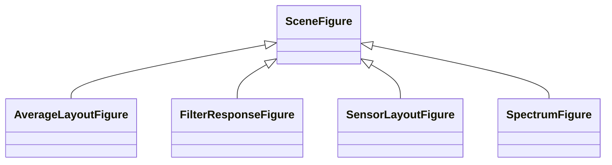

# SceneFigure

**Namespace:** `mne::viz` &nbsp;·&nbsp; **Library:** Visualization Library &nbsp;·&nbsp; **Source:** [`viz/figures/scene_figure.h`](https://github.com/mne-tools/mne-cpp/blob/staging/src/libs/mne/viz/figures/scene_figure.h)

`#include <mne/viz/scene_figure.h>`

```cpp
class mne::viz::SceneFigure
```

An interactive figure in scene coordinates: its bounds, how it draws and how it answers the pointer.

A host ([`FigureView`](/docs/api/viz/figure-view) without a toolkit, [`SceneViewport`](/docs/api/viz-qt/scene-viewport) in Qt) maps the scene to its window and passes clicks, hovers and rubber bands in scene coordinates. A zoomable figure is fitted, zoomed and panned by the host; a figure that is not zoomable lays itself out to the view size given in `resize()` and draws in view pixels, the host only scrolling it vertically. The figure tells its hosts to repaint through `changed()`.

### Inheritance



---

## Public Methods

### SceneFigure()

---

### ~SceneFigure()

---

### SceneFigure()

---

### operator=()

---

### bounds()

**Returns:**

- *[Rect](/docs/api/viz/rect)* — The area of the contents in scene coordinates; empty without contents.

---

### draw(canvas, metrics, font)

Draws the contents in scene coordinates; the host has already mapped them to its window.

**Parameters:**

- **canvas** : *[Canvas](/docs/api/viz/canvas) &*
  [`Canvas`](/docs/api/viz/canvas) to draw on.

- **metrics** : *const [TextMetrics](/docs/api/viz/text-metrics) &*
  Metrics of the host's fonts, to lay out text.

- **font** : *const [Font](/docs/api/viz/font) &*
  The host's base font.

---

### zoomable()

**Returns:**

- *bool* — Whether the host fits, zooms and pans the figure; otherwise it lays itself out to the view size.

---

### resize(width, height)

The view size changed; figures that are not zoomable lay themselves out to it.

**Parameters:**

- **width** : *double*
  Width of the view in pixels.

- **height** : *double*
  Height of the view in pixels.

---

### press(point, modifiers)

The left button went down.

**Parameters:**

- **point** : *[Point](/docs/api/viz/point)*
  Scene coordinates of the press.

- **modifiers** : *Modifier*
  Keyboard modifiers.

**Returns:**

- *bool* — Whether an item took the press; otherwise the host starts a rubber band if `band_selection_enabled()`.

---

### release(point)

The left button went up after `press()` took the press.

**Parameters:**

- **point** : *[Point](/docs/api/viz/point)*
  Scene coordinates of the release.

---

### hover(point)

The pointer moved over the figure without a button, or left it.

**Parameters:**

- **point** : *std::optional&lt; [Point](/docs/api/viz/point) &gt;*
  Scene coordinates of the pointer, or no value when it left.

---

### double_click(point)

The left button was clicked twice.

**Parameters:**

- **point** : *[Point](/docs/api/viz/point)*
  Scene coordinates of the click.

**Returns:**

- *bool* — Whether the figure used the click; otherwise the host fits a zoomable figure.

---

### band_selection_enabled()

**Returns:**

- *bool* — Whether a left drag outside an item spans a rubber band.

---

### band_selected(band, modifiers)

A rubber band was released.

**Parameters:**

- **band** : *const [Rect](/docs/api/viz/rect) &*
  The band in scene coordinates.

- **modifiers** : *Modifier*
  Keyboard modifiers at the start of the band.

---

### add_listener(listener)

**Parameters:**

- **listener** : *std::function&lt; void(Change)&gt;*
  Called on every change.

**Returns:**

- *int* — An id for `remove_listener()`.

---

### remove_listener(id)

**Parameters:**

- **id** : *int*
  Id from `add_listener()`; unknown ids are ignored.

---

## Example

No example of its own: Abstract contract of interactive figures; SensorLayoutFigure and AverageLayoutFigure implement it and the AverageLayoutPanel example shows one in use.

## Authors of this file

- Christoph Dinh &lt;christoph.dinh@mne-cpp.org&gt;
