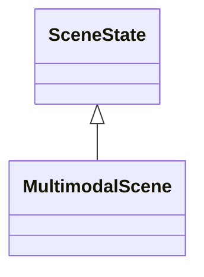

# SceneState

**Namespace:** `mne::viz` &nbsp;·&nbsp; **Library:** Visualization Library &nbsp;·&nbsp; **Source:** [`viz/brain/scenestate.h`](https://github.com/mne-tools/mne-cpp/blob/staging/src/libs/mne/viz/brain/scenestate.h)

`#include <mne/viz/scenestate.h>`

```cpp
class mne::viz::SceneState
```

Host-app-agnostic controller that owns the ordered renderable set and dispatches picks back to the producing layer.

Responsibilities:

- Maintain an ordered registry of [`SceneLayer`](/docs/api/viz/scene-layer) payloads keyed by id.
- [`Report`](/docs/api/report/report-class) to `setLayersChangedCallback()` whenever a layer is added, removed, or its visibility/opacity flips, so the renderer can rebuild its draw list.
- Maintain a shared timeline (current time index) that data overlays across modalities consume; reports changes to `setTimeSampleChangedCallback()`.
- Maintain the most recent [`PickResult`](/docs/api/viz/pick-result) and report it to `setPickedCallback()` when a layer producer reports a hit; consumers (Pick dock, status bar, MRI ortho viewer) subscribe to that signal.

It is a pure data/dispatch hub with no rendering logic; [`MultimodalScene`](/docs/api/viz-qt/multimodal-scene) adds Qt signals on top. The renderer (`BrainRenderer` or a future `MultimodalRenderer`) reads layers via `layers()` and per-kind downcasts the payload pointer.

```cpp title="src/examples/ex_disp3d_scene/main.cpp"
MultimodalScene scene;
scene.registerBoundsFn(SceneLayerKind::Electrode, [](const SceneLayer& layer, Vector3f& bbMin, Vector3f& bbMax) {
    const auto* object = static_cast<const ElectrodeObject*>(layer.payload.get());
    const Eigen::MatrixX3f positions = object->implantation().positions();
    bbMin = positions.colwise().minCoeff().transpose();
    bbMax = positions.colwise().maxCoeff().transpose();
    return true;
});
SceneLayer layer;
layer.id = "seeg_LH";
layer.kind = SceneLayerKind::Electrode;
auto payload = std::make_shared<ElectrodeObject>();
payload->setImplantation(electrodes.implantation());
layer.payload = payload;
scene.addLayer(layer);
scene.setOverlayThresholds(2.0f, 4.0f, 8.0f);
Vector3f bbMin;
Vector3f bbMax;
scene.worldBounds(bbMin, bbMax); // union over visible layers with a bounds function
```

### Inheritance



---

## Public Methods

### SceneState()

---

### ~SceneState()

---

### addLayer(layer)

Add or replace a layer.

If a layer with the same `SceneLayer::id` already exists, the stored layer is overwritten in place (preserving its slot in the draw order). Otherwise the new layer is appended to its kind's group.

**Parameters:**

- **layer** : *[SceneLayer](/docs/api/viz/scene-layer)*
  Layer record. The caller retains ownership of the underlying payload via the shared_ptr.

---

### removeLayer(id)

Remove a layer by id.

**Parameters:**

- **id** : *const std::string &*
  Layer id supplied to `addLayer`.

**Returns:**

- *bool* — true if a layer was removed, false if the id was unknown.

---

### clear()

Remove every layer.

---

### layers()

**Returns:**

- *std::vector&lt; [SceneLayer](/docs/api/viz/scene-layer) &gt;* — All layers in current draw order (sorted by kind, then by drawOrder, then by insertion order).

---

### findLayer(id)

**Parameters:**

- **id** : *const std::string &*
  Layer id.

**Returns:**

- *const [SceneLayer](/docs/api/viz/scene-layer) ** — Pointer to the layer with the given id, or nullptr. The pointer is valid only until the next mutation.

---

### setLayerVisible(id, visible)

Toggle visibility of a layer.

No-op if the id is unknown.

**Parameters:**

- **id** : *const std::string &*
  Layer id.

- **visible** : *bool*
  True to show the layer, false to hide it.

---

### setLayerOpacity(id, opacity)

Set per-layer opacity in [0, 1].

No-op if the id is unknown.

**Parameters:**

- **id** : *const std::string &*
  Layer id.

- **opacity** : *float*
  Opacity, clamped to [0, 1].

---

### currentTimeSample()

**Returns:**

- *int* — Current shared time index (used by data overlays). -1 if no time-resolved data is loaded.

---

### setCurrentTimeSample(sample)

Set the current time index.

Reports to `setTimeSampleChangedCallback()` if it actually changes. Negative values are clamped to -1.

**Parameters:**

- **sample** : *int*
  New time sample index, or -1 for no time-resolved data.

---

### timeCursor()

**Returns:**

- *double* — Current shared time cursor in seconds. Independent of the integer-sample timeline (`currentTimeSample`) — overlay widgets that drive a continuous time slider operate in seconds. Default 0.

---

### setTimeCursor(seconds)

Set the shared time cursor in seconds.

Reports to `setTimeCursorChangedCallback()` if the value actually changes.

**Parameters:**

- **seconds** : *double*
  New time cursor position in seconds.

---

### overlayFmin()

**Returns:**

- *float* — Current overlay min threshold. Default 0.

---

### overlayFmid()

**Returns:**

- *float* — Current overlay mid threshold. Default 0.5.

---

### overlayFmax()

**Returns:**

- *float* — Current overlay max threshold. Default 1.

---

### setOverlayThresholds(fmin, fmid, fmax)

Set the shared (fmin, fmid, fmax) overlay thresholds used by the data-driven Overlay dock and the renderables it drives.

The values are clamped to fmin &lt;= fmid &lt;= fmax. Reports to `setOverlayThresholdsChangedCallback()` if any value actually changes.

**Parameters:**

- **fmin** : *float*
  Minimum threshold.

- **fmid** : *float*
  Mid threshold, raised to fmin if smaller.

- **fmax** : *float*
  Maximum threshold, raised to fmid if smaller.

---

### lastPick()

**Returns:**

- *const [PickResult](/docs/api/viz/pick-result) &* — Most recent pick reported via `reportPick`. Default- constructed (kind == None) until the first hit.

---

### reportPick(pick)

[`Report`](/docs/api/report/report-class) a pick result from a layer's renderer or hit-tester.

Reports it to `setPickedCallback()`. Used by both real ray-cast picking and synthetic picks (e.g. wizard "show this contact" navigation).

**Parameters:**

- **pick** : *const [PickResult](/docs/api/viz/pick-result) &*
  Pick result to store as the last pick and broadcast.

---

### worldBounds(bbMin, bbMax)

Scene-wide axis-aligned bounding box union of all visible layers, computed by the supplied per-kind extractor.

The scene itself does not know how to read each payload type; the host registers extractors via `registerBoundsFn`.

**Parameters:**

- **bbMin** : *Eigen::Vector3f &*
  Minimum corner of the union box; (-1, -1, -1) if no layer contributed.

- **bbMax** : *Eigen::Vector3f &*
  Maximum corner of the union box; (1, 1, 1) if no layer contributed.

---

### registerBoundsFn(kind, fn)

Register an AABB extractor for a given layer kind.

Replaces any previously registered fn for that kind.

**Parameters:**

- **kind** : *SceneLayerKind*
  Layer kind the extractor handles.

- **fn** : *BoundsFn*
  Extractor returning false when the layer has no bounds.

---

### setLayersChangedCallback(callback)

Set the callback for layersChanged.

Called whenever the layer set or any layer flag (visibility, opacity, drawOrder) changes. The renderer should treat this as "rebuild the draw list". It runs on the thread that produced the result.

**Parameters:**

- **callback** : *std::function&lt; void()&gt;*
  Receives (nothing); empty to drop the results.

---

### setTimeSampleChangedCallback(callback)

Set the callback for timeSampleChanged.

Called when the shared time index changes. Data overlays and timeline scrubbers subscribe. It runs on the thread that produced the result.

**Parameters:**

- **callback** : *std::function&lt; void(int)&gt;*
  Receives (sample); empty to drop the results.

---

### setTimeCursorChangedCallback(callback)

Set the callback for timeCursorChanged.

Called when the shared time cursor (seconds) changes. Driven by the Overlay dock's continuous time slider; consumed by per-sample value lookup on electrodes / surface overlays. It runs on the thread that produced the result.

**Parameters:**

- **callback** : *std::function&lt; void(double)&gt;*
  Receives (seconds); empty to drop the results.

---

### setOverlayThresholdsChangedCallback(callback)

Set the callback for overlayThresholdsChanged.

Called when any of the shared overlay thresholds change. It runs on the thread that produced the result.

**Parameters:**

- **callback** : *std::function&lt; void(float, float, float)&gt;*
  Receives (fmin, fmid, fmax); empty to drop the results.

---

### setPickedCallback(callback)

Set the callback for picked.

Called when a pick is reported. Pick dock, status bar, and MRI ortho viewer subscribe. It runs on the thread that produced the result.

**Parameters:**

- **callback** : *std::function&lt; void(const [PickResult](/docs/api/viz/pick-result) &)&gt;*
  Receives (pick); empty to drop the results.

---

## Example

- Start here: [ex_disp3d_scene](../../examples/viz_qt/ex_disp3d_scene.mdx) — Disp3D scene data: sensor-to-surface interpolation, electrodes, MRI slices, video overlay and layers.
- Full source: [`src/examples/ex_disp3d_scene/main.cpp`](https://github.com/mne-tools/mne-cpp/tree/staging/src/examples/ex_disp3d_scene/main.cpp)
- Build target: `ex_disp3d_scene` (runs under CTest)

## Authors of this file

- Christoph Dinh &lt;christoph.dinh@mne-cpp.org&gt;
