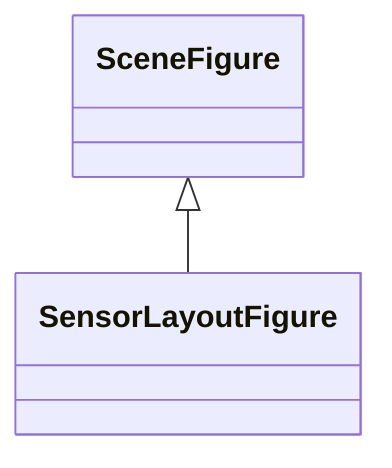

# SensorLayoutFigure

**Namespace:** `mne::viz` &nbsp;·&nbsp; **Library:** Visualization Library &nbsp;·&nbsp; **Source:** [`viz/figures/sensor_layout_figure.h`](https://github.com/mne-tools/mne-cpp/blob/staging/src/libs/mne/viz/figures/sensor_layout_figure.h)

`#include <mne/viz/sensor_layout_figure.h>`

```cpp
class mne::viz::SensorLayoutFigure
```

The sensors of one channel kind as labelled dots, picked by click, Ctrl+click and rubber band.

Sensors whose name contains "EEG" are EEG channels, all others MEG gradiometers. Only sensors of the shown kind are drawn, and only the selectable ones can be picked. As in a QGraphicsScene, sensors that are hidden or become unselectable lose their selection, and every change of the selection is reported.

### Inheritance



---

## Public Methods

### SensorLayoutFigure()

Constructs a figure without sensors that shows MEG channels.

---

### set_selection_callback(callback)

**Parameters:**

- **callback** : *std::function&lt; void()&gt;*
  Called when the selection changed.

---

### set_layout(layout, bad)

Sets the sensors, all unselected.

**Parameters:**

- **layout** : *const std::map&lt; std::string, [Point](/docs/api/viz/point) &gt; &*
  Layout position of each sensor by name, y pointing up.

- **bad** : *const std::vector&lt; std::string &gt; &*
  Names of the bad sensors.

---

### set_channel_kind(kind)

**Parameters:**

- **kind** : *int*
  Channel kind to show, FIFFV_MEG_CH or FIFFV_EEG_CH; applied by `set_selectable()`.

---

### channel_kind()

**Returns:**

- *int* — The channel kind shown.

---

### set_selectable(names)

Shows the sensors of the channel kind and lets only those in `names` be picked.

**Parameters:**

- **names** : *const std::vector&lt; std::string &gt; &*
  Names of the sensors that can be selected.

---

### select_names(names)

Selects the sensors named in `names` and deselects all others.

**Parameters:**

- **names** : *const std::vector&lt; std::string &gt; &*
  Names of the sensors to select.

---

### highlight_names(names)

Highlights the sensors named in `names` with an orange ring.

**Parameters:**

- **names** : *const std::vector&lt; std::string &gt; &*
  Names of the sensors to highlight.

---

### clear()

Removes all sensors.

---

### selected_names()

**Returns:**

- *std::vector&lt; std::string &gt;* — The names of the selected sensors, in layout order.

---

### selection()

**Returns:**

- *std::vector&lt; [SensorLayout](/docs/api/viz/sensor-layout)::Sensor &gt;* — The selected sensors, or all shown sensors if none is selected.

---

### sensor_layout()

**Returns:**

- *const [SensorLayout](/docs/api/viz/sensor-layout) &* — The sensors and their state.

---

### bounds()

**Returns:**

- *[Rect](/docs/api/viz/rect)* — The area of the contents in scene coordinates; empty without contents.

---

### draw(canvas, metrics, font)

Draws the contents in scene coordinates; the host has already mapped them to its window.

**Parameters:**

- **canvas** : *[Canvas](/docs/api/viz/canvas) &*
  [`Canvas`](/docs/api/viz/canvas) to draw on.

- **metrics** : *const [TextMetrics](/docs/api/viz/text-metrics) &*
  Metrics of the host's fonts, to lay out text.

- **font** : *const [Font](/docs/api/viz/font) &*
  The host's base font.

---

### press(point, modifiers)

The left button went down.

**Parameters:**

- **point** : *[Point](/docs/api/viz/point)*
  Scene coordinates of the press.

- **modifiers** : *Modifier*
  Keyboard modifiers.

**Returns:**

- *bool* — Whether an item took the press; otherwise the host starts a rubber band if `band_selection_enabled()`.

---

### band_selection_enabled()

**Returns:**

- *bool* — Whether a left drag outside an item spans a rubber band.

---

### band_selected(band, modifiers)

A rubber band was released.

**Parameters:**

- **band** : *const [Rect](/docs/api/viz/rect) &*
  The band in scene coordinates.

- **modifiers** : *Modifier*
  Keyboard modifiers at the start of the band.

---

## Example

No example of its own: The sensor picker of ChannelSelectionView; it needs a layout file and user input, exercised by test_viz_figure_view and test_viz_qt_viewers2.

## Authors of this file

- Christoph Dinh &lt;christoph.dinh@mne-cpp.org&gt;
