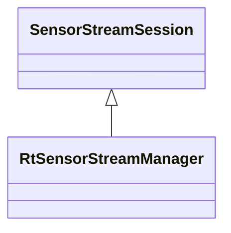

# SensorStreamSession

**Namespace:** `mne::viz` &nbsp;·&nbsp; **Library:** Visualization Library &nbsp;·&nbsp; **Source:** [`viz/brain/realtime/sensorstreamsession.h`](https://github.com/mne-tools/mne-cpp/blob/staging/src/libs/mne/viz/brain/realtime/sensorstreamsession.h)

`#include <mne/viz/sensorstreamsession.h>`

```cpp
class mne::viz::SensorStreamSession
```

Manages real-time sensor data streaming via [`RtSensorStream`](/docs/api/viz/rt-sensor-stream).

[BrainView](/docs/api/viz-qt/brain-view) delegates all sensor streaming operations to this component, keeping its own code free of the [`RtSensorStream`](/docs/api/viz/rt-sensor-stream) lifecycle. The colours reach the owner through its dispatcher, on the owner's thread.

Real-time sensor streaming lifecycle manager.

### Inheritance



---

## Public Methods

### SensorStreamSession(dispatcher)

Constructor.

**Parameters:**

- **dispatcher** : *Dispatcher*
  Hands the colours from the streaming thread to the owner's thread.

---

### ~SensorStreamSession()

Destructor.

---

### SensorStreamSession()

---

### operator=()

---

### startStreaming(modality, fieldMapper, surfaces)

Start real-time sensor streaming for the given modality.

Reads mapping matrices, pick vectors, evoked data, and colourmap from the provided `fieldMapper`. Validates that the target surface key exists in `surfaces`.

**Parameters:**

- **modality** : *const std::string &*
  "MEG" or "EEG".

- **fieldMapper** : *const [SensorFieldMapper](/docs/api/viz/sensor-field-mapper) &*
  Sensor-field mapper with built mapping data.

- **surfaces** : *const std::map&lt; std::string, std::shared_ptr&lt; [BrainSurface](/docs/api/viz/brain-surface) &gt; &gt; &*
  [`FsSurface`](/docs/api/fs/fs-surface) map for target-surface validation.

**Returns:**

- *bool* — true if streaming was started successfully.

---

### stopStreaming()

Stop real-time sensor streaming.

---

### isStreaming()

**Returns:**

- *bool* — true while real-time sensor streaming is active.

---

### modality()

**Returns:**

- *std::string* — the active modality ("MEG" or "EEG"), or empty.

---

### pushData(data)

Push a single measurement vector into the streaming queue.

**Parameters:**

- **data** : *const Eigen::VectorXf &*
  One sample of sensor values; ignored if no controller exists.

---

### setInterval(msec)

Set the streaming playback interval in milliseconds.

**Parameters:**

- **msec** : *int*
  Interval between streamed samples in milliseconds.

---

### setLooping(enabled)

Enable or disable looping of the streaming queue.

**Parameters:**

- **enabled** : *bool*
  True to replay the queue from the start when it ends.

---

### setAverages(numAvr)

Set the number of averages for smoothing.

**Parameters:**

- **numAvr** : *int*
  Number of consecutive samples averaged per frame.

---

### setColormap(name)

Set the colormap used for colour mapping.

**Parameters:**

- **name** : *const std::string &*
  `Colormap` name (e.g. "MNE", "Jet").

---

### setColorsAvailableCallback(callback)

Set the callback for colorsAvailable.

Called when the streaming pipeline produces a new set of per-vertex colours for a sensor surface. It runs on the thread that produced the result.

**Parameters:**

- **callback** : *std::function&lt; void(const std::string &, const std::vector&lt; uint32_t &gt; &)&gt;*
  Receives (surfaceKey, colors); empty to drop the results.

---

## Authors of this file

- Christoph Dinh &lt;christoph.dinh@mne-cpp.org&gt;
