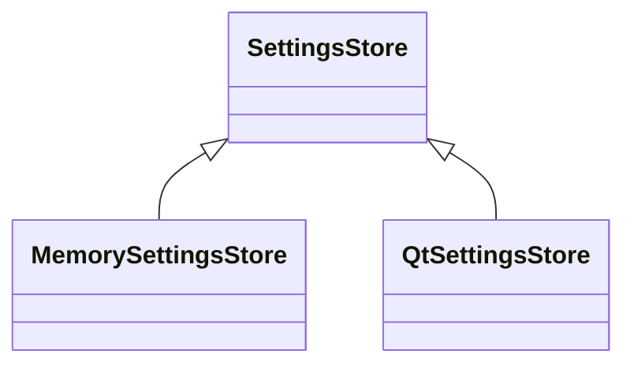

# SettingsStore

**Namespace:** `mne::viz` &nbsp;·&nbsp; **Library:** Visualization Library &nbsp;·&nbsp; **Source:** [`viz/host/settings_store.h`](https://github.com/mne-tools/mne-cpp/blob/staging/src/libs/mne/viz/host/settings_store.h)

`#include <mne/viz/settings_store.h>`

```cpp
class mne::viz::SettingsStore
```

Key/value storage for the persistent state of views.

```cpp title="src/examples/ex_disp3d_scene/main.cpp"
// A pane's camera, shaders and layer visibility survive a restart through any SettingsStore
MemorySettingsStore viewSettings; // QtSettingsStore puts the same keys into a QSettings
SubView pane = SubView::defaultForIndex(2);
pane.surfaceType = "inflated";
pane.visibility.setObjectVisible("dipoles", false);
pane.save(viewSettings, "multi2_");
SubView restored;
restored.load(viewSettings, "multi2_");
```

### Inheritance



---

## Public Methods

### ~SettingsStore()

---

### value(key)

**Parameters:**

- **key** : *const std::string &*
  `Key`.

**Returns:**

- *std::optional&lt; SettingValue &gt;* — The stored value, or nothing when `key` is absent.

---

### set_value(key, value)

Store `value` under `key`, replacing any previous value.

**Parameters:**

- **key** : *const std::string &*
  `Key`.

- **value** : *const SettingValue &*
  Value.

---

### contains(key)

**Parameters:**

- **key** : *const std::string &*
  `Key`.

**Returns:**

- *bool* — Whether a value is stored under `key`.

---

### read_bool(key, fallback)

**Parameters:**

- **key** : *const std::string &*
  `Key`.

- **fallback** : *bool*
  Result when `key` is absent or not a boolean ("true"/"false", "1"/"0" and numbers count).

**Returns:**

- *bool* — The stored boolean.

---

### read_int(key, fallback)

**Parameters:**

- **key** : *const std::string &*
  `Key`.

- **fallback** : *int*
  Result when `key` is absent or not a number.

**Returns:**

- *int* — The stored integer; floating-point values are rounded.

---

### read_double(key, fallback)

**Parameters:**

- **key** : *const std::string &*
  `Key`.

- **fallback** : *double*
  Result when `key` is absent or not a number.

**Returns:**

- *double* — The stored number.

---

### read_string(key, fallback)

**Parameters:**

- **key** : *const std::string &*
  `Key`.

- **fallback** : *const std::string &*
  Result when `key` is absent.

**Returns:**

- *std::string* — The stored text; other values are formatted as text.

---

## Example

- Start here: [ex_disp3d_scene](../../examples/viz_qt/ex_disp3d_scene.mdx) — Disp3D scene data: sensor-to-surface interpolation, electrodes, MRI slices, video overlay and layers.
- Full source: [`src/examples/ex_disp3d_scene/main.cpp`](https://github.com/mne-tools/mne-cpp/tree/staging/src/examples/ex_disp3d_scene/main.cpp)
- Build target: `ex_disp3d_scene` (runs under CTest)

## Authors of this file

- Christoph Dinh &lt;christoph.dinh@mne-cpp.org&gt;
