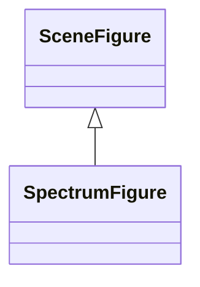

# SpectrumFigure

**Namespace:** `mne::viz` &nbsp;·&nbsp; **Library:** Visualization Library &nbsp;·&nbsp; **Source:** [`viz/figures/spectrum_figure.h`](https://github.com/mne-tools/mne-cpp/blob/staging/src/libs/mne/viz/figures/spectrum_figure.h)

`#include <mne/viz/spectrum_figure.h>`

```cpp
class mne::viz::SpectrumFigure
```

Spectra of the selected channels, one row each, between the frequency bounds.

The figure is not zoomable: it lays its rows out to the view width and the host scrolls them. Each row shows the channel name, a dotted frequency grid with labels and the spectrum scaled to its range between the bounds. The row under the pointer is drawn red, with a vertical line and the value and frequency of the nearest bin; a double click freezes the spectra, which are then drawn darker, and a second one thaws them.

```cpp title="src/examples/ex_scene_sdl/main.cpp"
auto info = std::make_shared<mne::FiffInfo>();
info->sfreq = kSfreq;
Eigen::MatrixXd spectra(kSpectrumChannels, kBins);
for (int i = 0; i < kSpectrumChannels; ++i) {
    mne::FiffChInfo channel;
    channel.ch_name = "EEG " + std::to_string(i + 1);
    info->chs.push_back(channel);
    info->ch_names.push_back(channel.ch_name);
    // 1/f background in dB with an alpha peak that grows towards the back of the head
    for (int bin = 0; bin < kBins; ++bin) {
        const double frequency = bin * (kSfreq / 2.0) / (kBins - 1);
        spectra(i, bin) = -10.0 * std::log10(frequency + 1.0) + (1.0 + i) * std::exp(-std::pow((frequency - 10.0) / 1.5, 2));
    }
}
info->nchan = kSpectrumChannels;

SpectrumPanel panel;
panel.init(info, SpectrumTable::Scale::Linear);
panel.add_data(spectra);
panel.set_boundaries(1.0f, 60.0f);

FigureView view(*panel.figure());
view.set_text_metrics(&metrics);
return host.run(view);
```

### Inheritance



---

## Public Methods

### set_info(info, scale)

Shows the channels of `info`, all selected, without data.

**Parameters:**

- **info** : *std::shared_ptr&lt; [FiffInfo](/docs/api/fiff/fiff-info) &gt;*
  Channels and sampling frequency.

- **scale** : *[SpectrumTable](/docs/api/viz/spectrum-table)::Scale*
  Spacing of the frequencies.

---

### set_data(data)

**Parameters:**

- **data** : *const Eigen::MatrixXd &*
  Spectrum of each channel (rows) from 0 Hz to the Nyquist frequency (columns).

---

### set_bounds(lower, upper)

Shows only the frequencies between `lower` and `upper`.

**Parameters:**

- **lower** : *float*
  Lower bound in Hz.

- **upper** : *float*
  Upper bound in Hz.

---

### select(channels)

Shows only some channels.

**Parameters:**

- **channels** : *const std::vector&lt; int &gt; &*
  Indices of the channels, in row order.

---

### reset_selection()

Shows all channels again.

---

### toggle_frozen()

Freezes the spectra shown, or thaws them.

---

### table()

**Returns:**

- *const [SpectrumTable](/docs/api/viz/spectrum-table) &* — The spectra, the selection and the frequency axis.

---

### readout()

**Returns:**

- *std::optional&lt; Readout &gt;* — The read-out under the pointer, if it is over a spectrum with data.

---

### bounds()

**Returns:**

- *[Rect](/docs/api/viz/rect)* — The area of the contents in scene coordinates; empty without contents.

---

### draw(canvas, metrics, font)

Draws the contents in scene coordinates; the host has already mapped them to its window.

**Parameters:**

- **canvas** : *[Canvas](/docs/api/viz/canvas) &*
  [`Canvas`](/docs/api/viz/canvas) to draw on.

- **metrics** : *const [TextMetrics](/docs/api/viz/text-metrics) &*
  Metrics of the host's fonts, to lay out text.

- **font** : *const [Font](/docs/api/viz/font) &*
  The host's base font.

---

### zoomable()

**Returns:**

- *bool* — Whether the host fits, zooms and pans the figure; otherwise it lays itself out to the view size.

---

### resize(width, height)

The view size changed; figures that are not zoomable lay themselves out to it.

**Parameters:**

- **width** : *double*
  Width of the view in pixels.

- **height** : *double*
  Height of the view in pixels.

---

### hover(point)

The pointer moved over the figure without a button, or left it.

**Parameters:**

- **point** : *std::optional&lt; [Point](/docs/api/viz/point) &gt;*
  Scene coordinates of the pointer, or no value when it left.

---

### double_click(point)

The left button was clicked twice.

**Parameters:**

- **point** : *[Point](/docs/api/viz/point)*
  Scene coordinates of the click.

**Returns:**

- *bool* — Whether the figure used the click; otherwise the host fits a zoomable figure.

---

## Example

- Start here: [ex_scene_sdl](../../examples/viz/ex_scene_sdl.mdx) — Trace view in an SDL3 window, without Qt: mne_scene's view and software renderer in another toolkit.
- Full source: [`src/examples/ex_scene_sdl/main.cpp`](https://github.com/mne-tools/mne-cpp/tree/staging/src/examples/ex_scene_sdl/main.cpp)
- Build target: `ex_scene_sdl` (runs under CTest)

## Authors of this file

- Christoph Dinh &lt;christoph.dinh@mne-cpp.org&gt;
