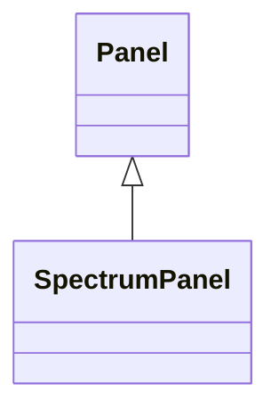

# SpectrumPanel

**Namespace:** `mne::viz` &nbsp;·&nbsp; **Library:** Visualization Library &nbsp;·&nbsp; **Source:** [`viz/panels/spectrum_panel.h`](https://github.com/mne-tools/mne-cpp/blob/staging/src/libs/mne/viz/panels/spectrum_panel.h)

`#include <mne/viz/spectrum_panel.h>`

```cpp
class mne::viz::SpectrumPanel
```

Tool panel with the spectra of the channels, one row each, as a [`SpectrumFigure`](/docs/api/viz/spectrum-figure).

Spectra that arrive before `init()` are dropped, as mne_scan may send them before the channels are known.

```cpp title="src/examples/ex_scene_sdl/main.cpp"
auto info = std::make_shared<mne::FiffInfo>();
info->sfreq = kSfreq;
Eigen::MatrixXd spectra(kSpectrumChannels, kBins);
for (int i = 0; i < kSpectrumChannels; ++i) {
    mne::FiffChInfo channel;
    channel.ch_name = "EEG " + std::to_string(i + 1);
    info->chs.push_back(channel);
    info->ch_names.push_back(channel.ch_name);
    // 1/f background in dB with an alpha peak that grows towards the back of the head
    for (int bin = 0; bin < kBins; ++bin) {
        const double frequency = bin * (kSfreq / 2.0) / (kBins - 1);
        spectra(i, bin) = -10.0 * std::log10(frequency + 1.0) + (1.0 + i) * std::exp(-std::pow((frequency - 10.0) / 1.5, 2));
    }
}
info->nchan = kSpectrumChannels;

SpectrumPanel panel;
panel.init(info, SpectrumTable::Scale::Linear);
panel.add_data(spectra);
panel.set_boundaries(1.0f, 60.0f);

FigureView view(*panel.figure());
view.set_text_metrics(&metrics);
return host.run(view);
```

### Inheritance



---

## Public Methods

### SpectrumPanel()

Constructs a panel without channels.

---

### ~SpectrumPanel()

---

### spectrum()

**Returns:**

- *[SpectrumFigure](/docs/api/viz/spectrum-figure) &* — The figure of the spectra.

---

### init(info, scale)

Shows the channels of `info`, without spectra until the next `add_data()`.

**Parameters:**

- **info** : *std::shared_ptr&lt; [FiffInfo](/docs/api/fiff/fiff-info) &gt;*
  Channels and sampling frequency.

- **scale** : *[SpectrumTable](/docs/api/viz/spectrum-table)::Scale*
  Spacing of the frequencies.

---

### add_data(data)

**Parameters:**

- **data** : *const Eigen::MatrixXd &*
  Spectrum of each channel (rows) from 0 Hz to the Nyquist frequency (columns); dropped before `init()`.

---

### set_boundaries(lower, upper)

Shows only the frequencies between `lower` and `upper`; ignored until data have arrived.

**Parameters:**

- **lower** : *float*
  Lower bound in Hz.

- **upper** : *float*
  Upper bound in Hz.

---

## Example

- Start here: [ex_scene_sdl](../../examples/viz/ex_scene_sdl.mdx) — Trace view in an SDL3 window, without Qt: mne_scene's view and software renderer in another toolkit.
- Full source: [`src/examples/ex_scene_sdl/main.cpp`](https://github.com/mne-tools/mne-cpp/tree/staging/src/examples/ex_scene_sdl/main.cpp)
- Build target: `ex_scene_sdl` (runs under CTest)

## Used in examples

### [ex_scene_sdl](../../examples/viz/ex_scene_sdl.mdx)

Trace view in an SDL3 window, without Qt: mne_scene's view and software renderer in another toolkit.

````cpp title="src/examples/ex_scene_sdl/main.cpp, line 193"
SpectrumPanel panel;
panel.init(info, SpectrumTable::Scale::Linear);
panel.add_data(spectra);
panel.set_boundaries(1.0f, 60.0f);
````

## Authors of this file

- Christoph Dinh &lt;christoph.dinh@mne-cpp.org&gt;
