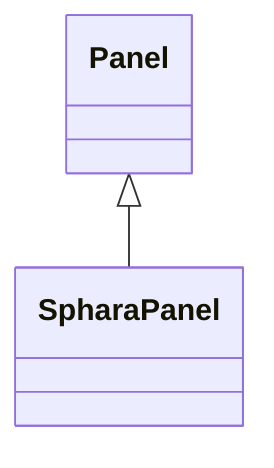

# SpharaPanel

**Namespace:** `mne::viz` &nbsp;·&nbsp; **Library:** Visualization Library &nbsp;·&nbsp; **Source:** [`viz/panels/sphara_panel.h`](https://github.com/mne-tools/mne-cpp/blob/staging/src/libs/mne/viz/panels/sphara_panel.h)

`#include <mne/viz/sphara_panel.h>`

```cpp
class mne::viz::SpharaPanel
```

Tool panel of SPHARA: whether it is active, the sensor system and the number of basis functions of its one or two sensor groups.

BabyMEG has an inner (up to 270) and an outer layer (105), VectorView magnetometers and gradiometers (102 each), EEG one group (256). The settings come from the plugin's defaults and are not stored.

### Inheritance



---

## Public Methods

### SpharaPanel()

Constructs the panel: inactive, BabyMEG with 270 and 105 basis functions.

---

### ~SpharaPanel()

---

### set_callbacks(callbacks)

**Parameters:**

- **callbacks** : *Callbacks*
  What to call on changes.

---

### active()

**Returns:**

- *bool* — Whether SPHARA is active.

---

### system()

**Returns:**

- *std::string* — "BabyMEG", "VectorView" or "EEG".

---

### first()

**Returns:**

- *int* — Basis functions of the first sensor group.

---

### second()

**Returns:**

- *int* — Basis functions of the second sensor group; unused for EEG.

---

## Example

No example of its own: Tool panel of an MNE Scan plugin, shown by the backends' panel hosts; works like CompensatorPanel, whose example shows the pattern.

## Authors of this file

- Christoph Dinh &lt;christoph.dinh@mne-cpp.org&gt;
