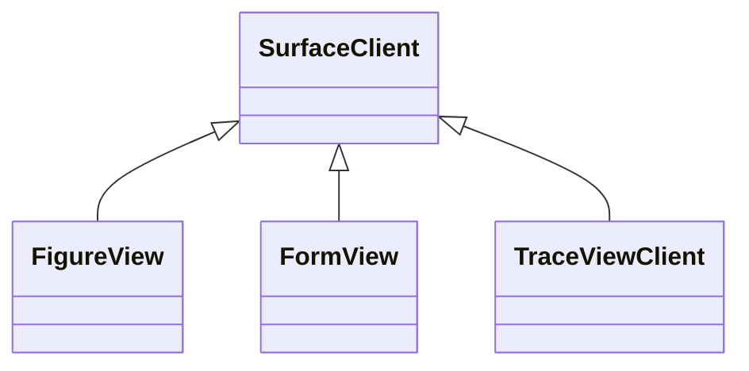

# SurfaceClient

**Namespace:** `mne::viz` &nbsp;·&nbsp; **Library:** Visualization Library &nbsp;·&nbsp; **Source:** [`viz/host/surface.h`](https://github.com/mne-tools/mne-cpp/blob/staging/src/libs/mne/viz/host/surface.h)

`#include <mne/viz/surface.h>`

```cpp
class mne::viz::SurfaceClient
```

The view's side: what a host drives.

### Inheritance



---

## Public Methods

### ~SurfaceClient()

Destroys the client.

---

### attach(surface)

Connects the client to the surface that shows it, or disconnects it with nullptr.

**Parameters:**

- **surface** : *[Surface](/docs/api/viz/surface) **
  The host's surface; it outlives the connection.

---

### surface()

**Returns:**

- *[Surface](/docs/api/viz/surface) ** — The surface the client is shown in, or nullptr.

---

### resize(size)

The surface changed its size.

**Parameters:**

- **size** : *const [SurfaceSize](/docs/api/viz/surface-size) &*
  The new size.

---

### handle_pointer(event)

A pointer pressed, moved, released or double-clicked over the surface.

**Parameters:**

- **event** : *const [PointerEvent](/docs/api/viz/pointer-event) &*
  The pointer event.

**Returns:**

- *bool* — Whether the client used the event.

---

### handle_wheel(event)

The wheel turned or the touchpad scrolled over the surface.

**Parameters:**

- **event** : *const [WheelEvent](/docs/api/viz/wheel-event) &*
  The wheel event.

**Returns:**

- *bool* — Whether the client used the event.

---

### handle_key(event)

A key was pressed while the surface had the focus.

**Parameters:**

- **event** : *const [KeyEvent](/docs/api/viz/key-event) &*
  The key event.

**Returns:**

- *bool* — Whether the client used the event.

---

### tick(now_ms)

Advances animations before a frame.

**Parameters:**

- **now_ms** : *std::int64_t*
  The surface's clock.

**Returns:**

- *bool* — Whether an animation still runs, so the host should draw another frame.

---

### frame(target)

Describes the next frame.

**Parameters:**

- **target** : *const [GpuFrameTarget](/docs/api/viz/gpu-frame-target) &*
  Pixel size and clip-space correction of the host's render target.

**Returns:**

- *[GpuFrame](/docs/api/viz/gpu-frame)* — The frame, referring to `resources()`.

---

### resources()

**Returns:**

- *const [GpuResources](/docs/api/viz/gpu-resources) &* — Buffers, textures and pipelines the frames refer to.

---

## Example

No example of its own: Interface of a hosted view; TraceViewClient implements it and ex_scene_sdl shows one in SDL.

## Authors of this file

- Christoph Dinh &lt;christoph.dinh@mne-cpp.org&gt;
