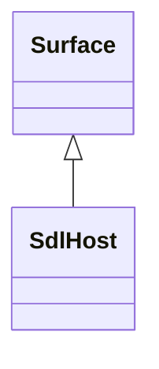

# Surface

**Namespace:** `mne::viz` &nbsp;·&nbsp; **Library:** Visualization Library &nbsp;·&nbsp; **Source:** [`viz/host/surface.h`](https://github.com/mne-tools/mne-cpp/blob/staging/src/libs/mne/viz/host/surface.h)

`#include <mne/viz/surface.h>`

```cpp
class mne::viz::Surface
```

The host's side: what a view may ask of the window it is shown in.

### Inheritance



---

## Public Methods

### ~Surface()

Destroys the surface.

---

### request_update()

Asks for a new frame; the host calls `SurfaceClient::frame()` soon, at most once per display refresh.

---

### set_cursor(shape)

Shows another pointer shape over the surface.

**Parameters:**

- **shape** : *CursorShape*
  The pointer shape.

---

### now_ms()

**Returns:**

- *std::int64_t* — Milliseconds of a monotonic clock, the time base of the input events and animations.

---

## Example

No example of its own: Interface a backend implements to host a view; mne::viz::sdl::SdlHost implements it and ex_scene_sdl uses it.

## Authors of this file

- Christoph Dinh &lt;christoph.dinh@mne-cpp.org&gt;
