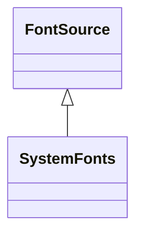

# SystemFonts

**Namespace:** `mne::viz` &nbsp;·&nbsp; **Library:** Visualization Library &nbsp;·&nbsp; **Source:** [`viz/figures/system_fonts.h`](https://github.com/mne-tools/mne-cpp/blob/staging/src/libs/mne/viz/figures/system_fonts.h)

`#include <mne/viz/system_fonts.h>`

```cpp
class mne::viz::SystemFonts
```

The TrueType fonts installed on the system, as a [`FontSource`](/docs/api/viz/font-source).

Without an explicit family, `face()` takes the first installed family of the preferred families; a [`Font`](/docs/api/viz/font)'s family is honoured when it is installed. Bold takes the lightest weight of at least 600 (SemiBold before Bold), else the regular face.

```cpp title="src/examples/ex_scene/main.cpp"
// Installed fonts, found without a font service; FontLibrary falls back to them
const std::shared_ptr<const FontFace> installed = SystemFonts::shared()->face(Font{});
```

### Inheritance



---

## Public Methods

### SystemFonts(directories, preferred_families)

**Parameters:**

- **directories** : *std::vector&lt; std::filesystem::path &gt;*
  Directories scanned recursively for .ttf, .ttc and .otf files.

- **preferred_families** : *std::vector&lt; std::string &gt;*
  Families tried in order for fonts without family.

---

### faces()

**Returns:**

- *const std::vector&lt; [SystemFontInfo](/docs/api/viz/system-font-info) &gt; &* — Every installed TrueType face, sorted by path; scanned on the first call.

---

### find(family, bold, italic)

**Parameters:**

- **family** : *std::string_view*
  Family name, compared case-insensitively.

- **bold** : *bool*
  Whether to prefer a weight of at least 600.

- **italic** : *bool*
  Whether to prefer an italic face.

**Returns:**

- *std::shared_ptr&lt; const [FontFace](/docs/api/viz/font-face) &gt;* — The best face of the family, or nullptr if it is not installed.

---

### face(font)

**Parameters:**

- **font** : *const [Font](/docs/api/viz/font) &*
  Requested family, weight and style; the size is ignored.

**Returns:**

- *std::shared_ptr&lt; const [FontFace](/docs/api/viz/font-face) &gt;* — The face that draws `font`, or nullptr if there is none.

---

### fallback_face(font, code_point)

**Parameters:**

- **font** : *const [Font](/docs/api/viz/font) &*
  Requested font, whose `face()` lacks `code_point`.

- **code_point** : *char32_t*
  Character to draw.

**Returns:**

- *std::shared_ptr&lt; const [FontFace](/docs/api/viz/font-face) &gt;* — Another face that has a glyph for `code_point`, or nullptr to draw the missing-glyph box.

---

## Static Methods

### shared()

**Returns:**

- *std::shared_ptr&lt; const [SystemFonts](/docs/api/viz/system-fonts) &gt;* — The fonts of `default_directories()`, shared by the whole process.

---

### default_directories()

**Returns:**

- *std::vector&lt; std::filesystem::path &gt;* — The font directories of the platform and of the user, then those listed in the environment variable MNE_FONT_PATH (separated by ':' or, on Windows, ';').

---

### default_families()

**Returns:**

- *std::vector&lt; std::string &gt;* — The user-interface families tried for fonts without family, Source Sans first.

---

## Example

- Start here: [ex_scene](../../examples/viz/ex_scene.mdx) — Scene library: draw a figure on a Canvas, plot a line chart, and write both as SVG and PNG without Qt.
- Full source: [`src/examples/ex_scene/main.cpp`](https://github.com/mne-tools/mne-cpp/tree/staging/src/examples/ex_scene/main.cpp)
- Build target: `ex_scene` (runs under CTest)

## Used in examples

### [ex_scene](../../examples/viz/ex_scene.mdx)

Scene library: draw a figure on a Canvas, plot a line chart, and write both as SVG and PNG without Qt.

````cpp title="src/examples/ex_scene/main.cpp, line 219"
// Installed fonts, found without a font service; FontLibrary falls back to them
const std::shared_ptr<const FontFace> installed = SystemFonts::shared()->face(Font{});
ok &= expect(typesetPng && face->family() == "Source Sans 3" && kerning < 0.0, "text is typeset in the bundled font, kerned");
std::println("        installed UI font: {}", installed ? installed->family() : std::string("none"));
````

## Authors of this file

- Christoph Dinh &lt;christoph.dinh@mne-cpp.org&gt;
