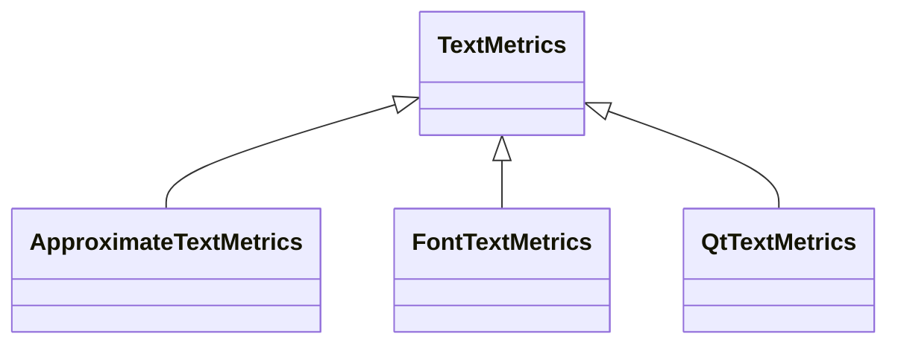

# TextMetrics

**Namespace:** `mne::viz` &nbsp;·&nbsp; **Library:** Visualization Library &nbsp;·&nbsp; **Source:** [`viz/figures/text_metrics.h`](https://github.com/mne-tools/mne-cpp/blob/staging/src/libs/mne/viz/figures/text_metrics.h)

`#include <mne/viz/text_metrics.h>`

```cpp
class mne::viz::TextMetrics
```

Measures text in a font.

```cpp title="src/examples/ex_scene/main.cpp"
// Qt:   QPainter p(&widget); p.setPen(...); p.drawRect(...); p.drawText(...);
Canvas canvas(200, 120, Color::white());
canvas.set_antialiasing(true);
canvas.set_pen(Pen{{50, 100, 150}, 1.5});
canvas.set_brush(Brush::solid({70, 130, 180}));
canvas.draw_rounded_rect({20, 20, 80, 50}, 6, 6);
canvas.set_pen(Color::black());
canvas.draw_text(Rect{0, 80, 200, 30}, Align::Center, "Hello scene");
const DisplayList figure = canvas.take();

// A plot: the same model a disp widget shows on screen
std::vector<double> x;
std::vector<double> y;
for (int i = 0; i < 100; ++i) {
    x.push_back(i * 0.01);
    y.push_back(std::sin(2 * 3.14159265358979 * 5 * x.back()));
}
LineChart plot;
plot.set_title("5 Hz sine");
plot.set_x_label("time (s)");
plot.add_series(x, y, "signal");
const ApproximateTextMetrics metrics;
const DisplayList chart = plot.render(480, 320, metrics, Font{"", 0.0, 13.0});

const Expected<void> svg = write_svg(chart, dir / "plot.svg");
const Expected<void> png = to_raster(chart).save_png(dir / "plot.png");
```

### Inheritance



---

## Public Methods

### ~TextMetrics()

---

### pixel_size(font)

**Parameters:**

- **font** : *const [Font](/docs/api/viz/font) &*
  [`Font`](/docs/api/viz/font) of the text.

**Returns:**

- *double* — The font size in pixels.

---

### advance(font, text)

**Parameters:**

- **font** : *const [Font](/docs/api/viz/font) &*
  [`Font`](/docs/api/viz/font) of the text.

- **text** : *std::string_view*
  UTF-8 text.

**Returns:**

- *double* — The width of `text` in `font`, in pixels.

---

### ascent(font)

**Parameters:**

- **font** : *const [Font](/docs/api/viz/font) &*
  [`Font`](/docs/api/viz/font) of the text.

**Returns:**

- *double* — The distance from the baseline to the top of the tallest glyphs.

---

### descent(font)

**Parameters:**

- **font** : *const [Font](/docs/api/viz/font) &*
  [`Font`](/docs/api/viz/font) of the text.

**Returns:**

- *double* — The distance from the baseline to the bottom of the lowest glyphs.

---

### height(font)

**Parameters:**

- **font** : *const [Font](/docs/api/viz/font) &*
  [`Font`](/docs/api/viz/font) of the text.

**Returns:**

- *double* — The line height, `ascent()` + `descent()` (+ leading).

---

### cap_height(font)

**Parameters:**

- **font** : *const [Font](/docs/api/viz/font) &*
  [`Font`](/docs/api/viz/font) of the text.

**Returns:**

- *double* — The height of capital letters above the baseline, or 0 if unknown; renderers centre the capitals of vertically centred text when it is known.

---

## Example

- Start here: [ex_scene](../../examples/viz/ex_scene.mdx) — Scene library: draw a figure on a Canvas, plot a line chart, and write both as SVG and PNG without Qt.
- Full source: [`src/examples/ex_scene/main.cpp`](https://github.com/mne-tools/mne-cpp/tree/staging/src/examples/ex_scene/main.cpp)
- Build target: `ex_scene` (runs under CTest)

## Used in examples

### [ex_scene_sdl](../../examples/viz/ex_scene_sdl.mdx)

Trace view in an SDL3 window, without Qt: mne_scene's view and software renderer in another toolkit.

````cpp title="src/examples/ex_scene_sdl/main.cpp, line 107"
 *
 * @return The number of frames drawn.
 */
int run_average_layout(sdl::SdlHost& host, const TextMetrics& metrics)
{
    constexpr int kSensors = 16;
    constexpr int kSamples = 300;
    constexpr int kPreStimulus = 100;
    // An N100-like deflection that grows towards the back of the grid, and a later positive wave
    auto info = std::make_shared<mne::FiffInfo>();
    Eigen::MatrixXd auditory = Eigen::MatrixXd::Zero(kSensors, kSamples);
    std::vector<AverageLayoutFigure::Channel> selection;
    for (int i = 0; i < kSensors; ++i) {
````

## Authors of this file

- Christoph Dinh &lt;christoph.dinh@mne-cpp.org&gt;
