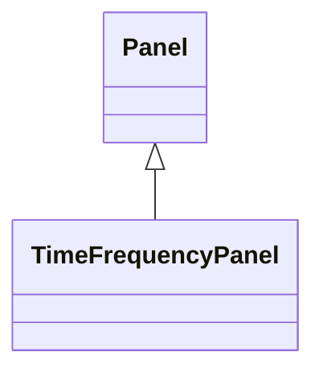

# TimeFrequencyPanel

**Namespace:** `mne::viz` &nbsp;·&nbsp; **Library:** Visualization Library &nbsp;·&nbsp; **Source:** [`viz/panels/time_frequency_panel.h`](https://github.com/mne-tools/mne-cpp/blob/staging/src/libs/mne/viz/panels/time_frequency_panel.h)

`#include <mne/viz/time_frequency_panel.h>`

```cpp
class mne::viz::TimeFrequencyPanel
```

Tool panel of a time-frequency plot: the trial and the row (channel) it shows.

### Inheritance



---

## Public Methods

### TimeFrequencyPanel()

Constructs the panel with trial 0 and row 0.

---

### ~TimeFrequencyPanel()

---

### set_callback(callback)

**Parameters:**

- **callback** : *std::function&lt; void(int trial, int row)&gt;*
  Called with the trial and the row when either changed.

---

### trial()

**Returns:**

- *int* — The trial.

---

### row()

**Returns:**

- *int* — The row.

---

## Example

No example of its own: Tool panel of an MNE Scan plugin, shown by the backends' panel hosts; works like CompensatorPanel, whose example shows the pattern.

## Authors of this file

- Christoph Dinh &lt;christoph.dinh@mne-cpp.org&gt;
