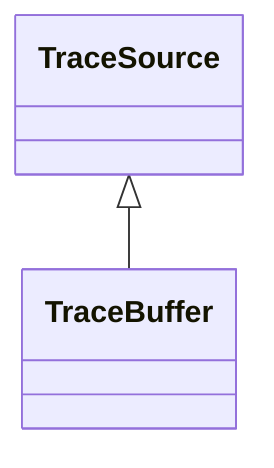

# TraceBuffer

**Namespace:** `mne::viz` &nbsp;·&nbsp; **Library:** Visualization Library &nbsp;·&nbsp; **Source:** [`viz/views/trace_buffer.h`](https://github.com/mne-tools/mne-cpp/blob/staging/src/libs/mne/viz/views/trace_buffer.h)

`#include <mne/viz/trace_buffer.h>`

```cpp
class mne::viz::TraceBuffer
```

The samples of a raw-data trace view and the description of its channels, as a [`TraceSource`](/docs/api/viz/trace-source).

Stores the samples of every channel from an absolute first sample on (replaced, or appended to with an optional capacity beyond which the oldest samples are dropped) and resolves the channels the host describes (`ChannelSpec`) into what the view draws: the amplitude scale from a scale map keyed by the host's channel kinds, the colour from the signal colour when the host gives none, and the bad flags. Stored rows beyond the described channels show as "CH n" of type "MISC". Traces are decimated with `decimate_trace()` and detrended on the fly. Channels are addressed by their stored index.

All accessors are thread-safe; writers notify the listeners after releasing the lock.

### Inheritance



---

## Public Methods

### add_listener(listener)

Registers a listener.

**Parameters:**

- **listener** : *Listener*
  Called after each change.

**Returns:**

- *int* — The id to remove it with.

---

### remove_listener(id)

Removes a listener.

**Parameters:**

- **id** : *int*
  Id from `add_listener()`.

---

### set_spec_provider(provider)

Sets where the channel descriptions come from.

Nothing is resolved until `reload_channels()` or a change of the scale map or signal colour.

**Parameters:**

- **provider** : *SpecProvider*
  Supplies the channel descriptions.

---

### reload_channels(clear_data)

Reads the channel descriptions again and sizes the samples to them.

**Parameters:**

- **clear_data** : *bool*
  Drop all samples and restart at sample 0 (notifies Channels only); otherwise keep the samples of the remaining channels (notifies Channels, then Data).

---

### set_channels(channels)

Describes the channels, keeping the samples of the remaining ones (a fixed `set_spec_provider()` and reload_channels(false)).

**Parameters:**

- **channels** : *std::vector&lt; ChannelSpec &gt;*
  The channel descriptions.

---

### set_data(data, first_sample)

Replaces all samples.

**Parameters:**

- **data** : *const Eigen::MatrixXd &*
  Channels x samples; empty data is ignored.

- **first_sample** : *int*
  Absolute sample of column 0.

---

### append_data(data)

Appends samples, dropping the oldest beyond the capacity.

**Parameters:**

- **data** : *const Eigen::MatrixXd &*
  Channels x new samples; empty data is ignored.

---

### clear_data()

Drops all samples and restarts at sample 0; the channels stay.

---

### set_capacity(samples)

Limits the stored samples per channel; appending beyond drops the oldest.

**Parameters:**

- **samples** : *int*
  The capacity, 0 (or less) for no limit.

---

### set_scale_map(scales)

Sets the amplitude scales.

**Parameters:**

- **scales** : *std::map&lt; int, float &gt;*
  Amplitude scale per key (see `ChannelSpec::scale_keys`).

---

### scale_map()

**Returns:**

- *std::map&lt; int, float &gt;* — The amplitude scales.

---

### set_signal_color(color)

Sets the colour of channels without their own colour.

**Parameters:**

- **color** : *[Color](/docs/api/viz/color)*
  The signal colour.

---

### set_channel_bad(index, bad)

Marks a channel bad or good until its channels are resolved again.

**Parameters:**

- **index** : *int*
  `Channel` index.

- **bad** : *bool*
  Whether it is bad.

---

### set_detrend(detrend)

Sets the detrending of the traces.

**Parameters:**

- **detrend** : *Detrend*
  Detrending per trace window.

---

### detrend()

**Returns:**

- *Detrend* — The detrending of the traces.

---

### set_sample_rate(hz)

Sets the sampling rate the host reports.

**Parameters:**

- **hz** : *float*
  Samples per second.

---

### sample_rate()

**Returns:**

- *float* — The sampling rate, 0 if unknown.

---

### is_virtual(index)

Tells whether a channel is a virtual channel of the host.

**Parameters:**

- **index** : *int*
  `Channel` index.

**Returns:**

- *bool* — Whether it is virtual; false for an unknown channel.

---

### rms(index, first, last)

Returns the RMS of a channel over a window, from at most its last 1000 samples.

**Parameters:**

- **index** : *int*
  `Channel` index.

- **first** : *int*
  Absolute first sample.

- **last** : *int*
  Absolute end sample (exclusive).

**Returns:**

- *float* — The RMS in physical units, 0 without data.

---

### channel_count()

**Returns:**

- *int* — The number of logical channels the view scrolls through.

---

### channel(index)

**Parameters:**

- **index** : *int*
  Logical channel index.

**Returns:**

- *std::optional&lt; Channel &gt;* — The channel, or nothing if `index` maps to no channel.

---

### value_at(index, sample)

**Parameters:**

- **index** : *int*
  Logical channel index.

- **sample** : *int*
  Absolute sample index.

**Returns:**

- *float* — The raw value of the channel at `sample` in physical units, 0 if unknown.

---

### first_sample()

**Returns:**

- *int* — The first sample that can be scrolled to (the first loaded sample).

---

### sample_count()

**Returns:**

- *int* — The number of loaded samples from `first_sample()` on.

---

### vertices(index, first, last, pixel_width)

Returns the trace of a channel over a sample window, decimated to min/max pairs when the window has more than two samples per pixel (see `decimate_trace()`).

**Parameters:**

- **index** : *int*
  Logical channel index.

- **first** : *int*
  Absolute first sample.

- **last** : *int*
  Absolute end sample (exclusive).

- **pixel_width** : *int*
  Pixels the window spans.

**Returns:**

- *[TraceVertices](/docs/api/viz/trace-vertices)* — The vertices, empty if there is no data; first_sample is clamped to the loaded data.

---

## Example

No example of its own: Sample store and channel resolution of the raw-data trace view; wrapped by viz::qt::ChannelDataModel and exercised by test_viz_trace_buffer, it has no standalone use without a trace host.

## Used in examples

### [ex_scene_sdl](../../examples/viz/ex_scene_sdl.mdx)

Trace view in an SDL3 window, without Qt: mne_scene's view and software renderer in another toolkit.

````cpp title="src/examples/ex_scene_sdl/main.cpp, line 112"
// The channels and the first seconds of the recording
TraceBuffer buffer;
std::vector<TraceBuffer::ChannelSpec> specs;
for (int ch = 0; ch < kChannels; ++ch) {
    TraceBuffer::ChannelSpec spec;
    spec.name = "EEG " + std::to_string(ch + 1);
    spec.type_label = "EEG";
    spec.color = Color{170, 55, 10};
    spec.default_scale = 40e-6f;
    spec.bad = ch == 5;
    specs.push_back(std::move(spec));
}
buffer.set_channels(std::move(specs));
buffer.set_sample_rate(static_cast<float>(kSfreq));
````

## Authors of this file

- Christoph Dinh &lt;christoph.dinh@mne-cpp.org&gt;
