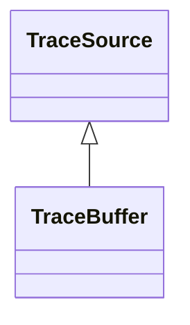

# TraceSource

**Namespace:** `mne::viz` &nbsp;·&nbsp; **Library:** Visualization Library &nbsp;·&nbsp; **Source:** [`viz/views/trace_source.h`](https://github.com/mne-tools/mne-cpp/blob/staging/src/libs/mne/viz/views/trace_source.h)

`#include <mne/viz/trace_source.h>`

```cpp
class mne::viz::TraceSource
```

The channels a trace view shows: their description, values and trace vertices.

Channels are addressed by their logical index: the position in the list of channels the view scrolls through, after any channel filter of the host.

### Inheritance



---

## Public Methods

### ~TraceSource()

---

### channel_count()

**Returns:**

- *int* — The number of logical channels the view scrolls through.

---

### channel(index)

**Parameters:**

- **index** : *int*
  Logical channel index.

**Returns:**

- *std::optional&lt; Channel &gt;* — The channel, or nothing if `index` maps to no channel.

---

### value_at(index, sample)

**Parameters:**

- **index** : *int*
  Logical channel index.

- **sample** : *int*
  Absolute sample index.

**Returns:**

- *float* — The raw value of the channel at `sample` in physical units, 0 if unknown.

---

### groups()

**Returns:**

- *std::vector&lt; Group &gt;* — The lanes of the butterfly mode, in display order. By default one lane per channel type in the order of the types' first channels, with the scale of that channel.

---

### first_sample()

**Returns:**

- *int* — The first sample that can be scrolled to (the first loaded sample).

---

### sample_count()

**Returns:**

- *int* — The number of loaded samples from `first_sample()` on.

---

### vertices(index, first, last, pixel_width)

Returns the trace of a channel over a sample window, decimated to min/max pairs when the window has more than two samples per pixel (see `decimate_trace()`).

**Parameters:**

- **index** : *int*
  Logical channel index.

- **first** : *int*
  Absolute first sample.

- **last** : *int*
  Absolute end sample (exclusive).

- **pixel_width** : *int*
  Pixels the window spans.

**Returns:**

- *[TraceVertices](/docs/api/viz/trace-vertices)* — The vertices, empty if there is no data; first_sample is clamped to the loaded data.

---

## Example

No example of its own: Interface a trace host implements to feed TraceView; viz::qt::ChannelRhiRenderer adapts its channel model to it.

## Authors of this file

- Christoph Dinh &lt;christoph.dinh@mne-cpp.org&gt;
