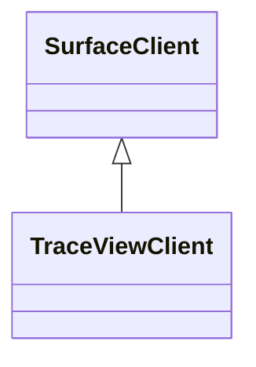

# TraceViewClient

**Namespace:** `mne::viz` &nbsp;·&nbsp; **Library:** Visualization Library &nbsp;·&nbsp; **Source:** [`viz/host/trace_view_client.h`](https://github.com/mne-tools/mne-cpp/blob/staging/src/libs/mne/viz/host/trace_view_client.h)

`#include <mne/viz/trace_view_client.h>`

```cpp
class mne::viz::TraceViewClient
```

The trace view with its animator, markers, style and frame builder, hosted through a [`Surface`](/docs/api/viz/surface).

```cpp title="src/examples/ex_scene_sdl/main.cpp"
TraceViewClient client;
client.style().background = Color{250, 250, 250};
TraceView& view = client.view();
view.set_sfreq(kSfreq);
view.set_first_file_sample(0);
view.set_visible_channel_count(16);
view.set_samples_per_pixel(5.0);
view.set_scalebars_visible(true);
client.set_source(&buffer);
client.set_text_metrics(&metrics);
```

### Inheritance



---

## Public Methods

### TraceViewClient()

Creates the client with the default style and approximate text metrics.

---

### TraceViewClient()

---

### operator=()

---

### set_source(source)

Sets the channels and samples to show.

**Parameters:**

- **source** : *const [TraceSource](/docs/api/viz/trace-source) **
  The data; it outlives the client or is replaced first.

---

### data_changed()

Tells the client that the samples of the source changed, e.g.

new data streamed in.

---

### set_effects(effects)

Sets the callbacks of the application.

The client handles animations, caches and redraws itself and calls these afterwards, e.g. to update a scroll bar or a status line.

**Parameters:**

- **effects** : *[TraceView](/docs/api/viz/trace-view)::Effects*
  Callbacks; the animation entries are not used.

---

### set_text_metrics(metrics)

Sets the text metrics used to lay out labels.

**Parameters:**

- **metrics** : *const [TextMetrics](/docs/api/viz/text-metrics) **
  Metrics of the host's font; nullptr restores the approximate metrics.

---

### view()

**Returns:**

- *[TraceView](/docs/api/viz/trace-view) &* — The view: viewport, input handling and overlays.

---

### markers()

**Returns:**

- *[TraceMarkers](/docs/api/viz/trace-markers) &* — Event and epoch markers drawn over the traces.

---

### style()

**Returns:**

- *[TraceStyle](/docs/api/viz/trace-style) &* — Colours and line widths of the frames.

---

### builder()

**Returns:**

- *[TraceFrameBuilder](/docs/api/viz/trace-frame-builder) &* — The frame builder with its vertex cache.

---

### animator()

**Returns:**

- *[ViewAnimator](/docs/api/viz/view-animator) &* — The scroll and zoom animations.

---

### resize(size)

The surface changed its size.

**Parameters:**

- **size** : *const [SurfaceSize](/docs/api/viz/surface-size) &*
  The new size.

---

### handle_pointer(event)

A pointer pressed, moved, released or double-clicked over the surface.

**Parameters:**

- **event** : *const [PointerEvent](/docs/api/viz/pointer-event) &*
  The pointer event.

**Returns:**

- *bool* — Whether the client used the event.

---

### handle_wheel(event)

The wheel turned or the touchpad scrolled over the surface.

**Parameters:**

- **event** : *const [WheelEvent](/docs/api/viz/wheel-event) &*
  The wheel event.

**Returns:**

- *bool* — Whether the client used the event.

---

### tick(now_ms)

Advances animations before a frame.

**Parameters:**

- **now_ms** : *std::int64_t*
  The surface's clock.

**Returns:**

- *bool* — Whether an animation still runs, so the host should draw another frame.

---

### frame(target)

Describes the next frame.

**Parameters:**

- **target** : *const [GpuFrameTarget](/docs/api/viz/gpu-frame-target) &*
  Pixel size and clip-space correction of the host's render target.

**Returns:**

- *[GpuFrame](/docs/api/viz/gpu-frame)* — The frame, referring to `resources()`.

---

### resources()

**Returns:**

- *const [GpuResources](/docs/api/viz/gpu-resources) &* — Buffers, textures and pipelines the frames refer to.

---

## Example

- Start here: [ex_scene_sdl](../../examples/viz/ex_scene_sdl.mdx) — Trace view in an SDL3 window, without Qt: mne_scene's view and software renderer in another toolkit.
- Full source: [`src/examples/ex_scene_sdl/main.cpp`](https://github.com/mne-tools/mne-cpp/tree/staging/src/examples/ex_scene_sdl/main.cpp)
- Build target: `ex_scene_sdl` (runs under CTest)

## Used in examples

### [ex_scene_sdl](../../examples/viz/ex_scene_sdl.mdx)

Trace view in an SDL3 window, without Qt: mne_scene's view and software renderer in another toolkit.

````cpp title="src/examples/ex_scene_sdl/main.cpp, line 321"
TraceViewClient client;
client.style().background = Color{250, 250, 250};
TraceView& view = client.view();
view.set_sfreq(kSfreq);
view.set_first_file_sample(0);
view.set_visible_channel_count(16);
view.set_samples_per_pixel(5.0);
view.set_scalebars_visible(true);
client.set_source(&buffer);
client.set_text_metrics(&metrics);
````

## Authors of this file

- Christoph Dinh &lt;christoph.dinh@mne-cpp.org&gt;
