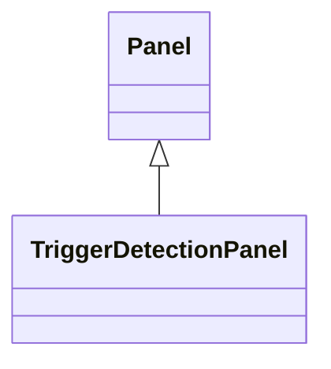

# TriggerDetectionPanel

**Namespace:** `mne::viz` &nbsp;·&nbsp; **Library:** Visualization Library &nbsp;·&nbsp; **Source:** [`viz/panels/trigger_detection_panel.h`](https://github.com/mne-tools/mne-cpp/blob/staging/src/libs/mne/viz/panels/trigger_detection_panel.h)

`#include <mne/viz/trigger_detection_panel.h>`

```cpp
class mne::viz::TriggerDetectionPanel
```

Tool panel of the trigger detection: the stimulus channel, the threshold as mantissa and decimal exponent, and in real-time mode the activation, a colour per detected trigger type and the number of detected triggers; offline it offers to detect the triggers once.

The settings keep the keys of the former TriggerDetectionView (Activated, ChannelIndex, FirstThresholdValue, SecondThresholdValue); the colours are stored as "#rrggbb" under Colors/ followed by the trigger type.

### Inheritance



---

## Public Methods

### TriggerDetectionPanel()

Constructs the panel for real-time data; it reports once `init()` gave it the measurement info.

---

### ~TriggerDetectionPanel()

---

### set_callbacks(callbacks)

**Parameters:**

- **callbacks** : *Callbacks*
  The reports of the panel.

---

### init(info)

Offers the stimulus channels of `info`, selects the stored one and reports the detection settings.

**Parameters:**

- **info** : *const [FiffInfo](/docs/api/fiff/fiff-info) &*
  Measurement info.

---

### set_detected_triggers(total, triggers)

Shows the number of detected triggers and adds the new trigger types to the colour choice.

**Parameters:**

- **total** : *int*
  Number of detected triggers.

- **triggers** : *const std::map&lt; int, std::vector&lt; std::pair&lt; int, double &gt; &gt; &gt; &*
  Detected triggers by channel as (sample, value) pairs; the values are the types.

---

### selected_stim_channel()

**Returns:**

- *std::string* — The selected stimulus channel, or an empty name.

---

### threshold()

**Returns:**

- *double* — The threshold, mantissa times ten to the exponent.

---

### active()

**Returns:**

- *bool* — Whether the real-time detection is active.

---

### colors()

**Returns:**

- *const std::map&lt; double, std::string &gt; &* — The colours ("#rrggbb") by trigger type.

---

### load(store, path)

Restores the settings without reporting them.

**Parameters:**

- **store** : *const [SettingsStore](/docs/api/viz/settings-store) &*
  Settings store.

- **path** : *const std::string &*
  Settings path.

---

### save(store, path)

**Parameters:**

- **store** : *[SettingsStore](/docs/api/viz/settings-store) &*
  Settings store.

- **path** : *const std::string &*
  Settings path.

---

## Example

No example of its own: Tool panel of an MNE Scan and MNE Analyze plugin, shown by the backends' panel hosts; works like CompensatorPanel, whose example shows the pattern.

## Authors of this file

- Christoph Dinh &lt;christoph.dinh@mne-cpp.org&gt;
